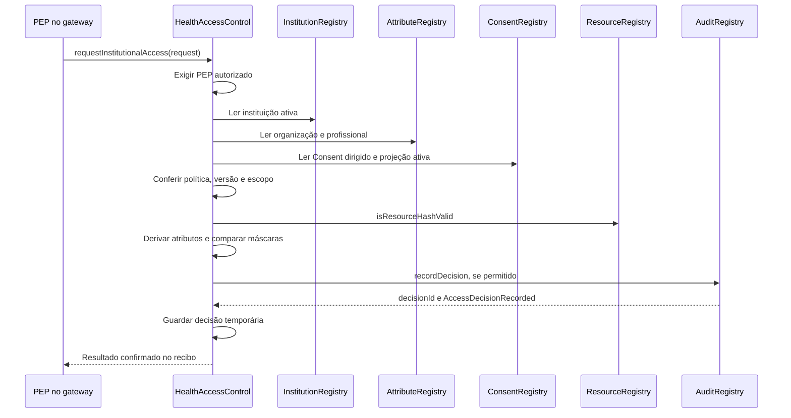

# InterFHIR — dois fluxos ponta a ponta explicados

> Avaliação atual da monografia: 15/10/2026, **430 testes e 22 cenários E2E aprovados**, incluindo duas políticas distintas, três profissionais autorizados e adulteração histórica real no HAPI. Consulte a [campanha ampliada](avaliacao-ampliada-2026-10-15.md) para fontes, resultados, reprodução e ocorrência operacional preservada. Os exemplos e relatórios datados de setembro abaixo continuam identificados como históricos.

Este documento detalha **um fluxo de sucesso** e **um fluxo negado por profissional divergente do Consent**, da preparação ao resultado HTTP. Complementa o [guia técnico](tcc-project-guide.md) e o [contrato HTTP](openapi.yaml).

## 1. Como interpretar os exemplos

Os payloads abaixo são uma **reconstrução didática baseada no código**, não uma captura integral de uma sessão. Valores clínicos são sintéticos. Tokens, assinaturas, handoffs, chaves e hashes calculados são representados por marcadores. Não são credenciais utilizáveis e não devem ser copiados como entradas prontas para execução.

As evidências reais estão na seção 6, separadas dos exemplos. Relatórios reais omitem segredos e conteúdo clínico deliberadamente.

Convenções:

| Símbolo/valor | Uso |
| --- | --- |
| A | https://localhost:3001, gateway Hospital A |
| FHIR_A | http://hospital-a-fhir:8080/fhir, serviço interno |
| KEYCLOAK | http://localhost:8180, acesso do harness no host |
| RPC | http://localhost:8546, acesso local ao Besu |
| CLIENT_ID | clinic-b-gateway |
| H(x) | Keccak-256 dos bytes UTF-8 de x |
| CP | consentProjectionHash calculado do Consent persistido |
| RH | hash canônico da Observation persistida |
| MC | commitment do manifesto ativo |
| AH | assertionHash da assertion assinada; convertido para bytes32 na chamada on-chain |
| TX_* | hash da transação correspondente, conhecido só após envio |
| <...> | Valor dinâmico, abreviado ou secreto deliberadamente omitido |

Exemplo temporal: início em 2026-09-06T22:50:00.000Z, fim em 2026-09-06T23:50:00.000Z. Epochs correspondentes: 1788735000 e 1788738600. São horários ilustrativos históricos; um novo ensaio deve gerar tempos válidos. Tokens do exemplo expiram em cinco minutos.

O identificador de operação ilustrativo é op_11111111-1111-4111-8111-111111111111. Share e manifesto compartilham esse sufixo. A referência do Consent contém também um trecho do digest calculado. Onde aparece <consent-id>, usar a referência retornada, sem inventar seu digest.

## 2. Preparação comum aos dois fluxos

### Como acompanhar os valores sem confundir suas origens

Os exemplos contêm valores fornecidos pelo cliente e valores produzidos pelos serviços. A origem importa: se o leitor imaginar que o solicitante escolhe todos os hashes e identidades, perderá a função das verificações.

| Valor | Quem o define | Onde reaparece |
| --- | --- | --- |
| patientReference | Token OIDC validado | Consent e comparação de titularidade |
| granteeOrganizationReference e practitionerReference do Consent | Pedido do paciente, sujeito às validações da rede | Consent persistido e projeção |
| organizationReference e practitionerReference da leitura | Claims do token UDAP validado | Comparação com share/Consent e chamada ABAC |
| Idempotency-Key | Cliente que pede criação | Busca/controle da operação de criação |
| operationId | Serviço de Consent | Acompanhamento interno da criação e resposta |
| consentReference | Referência planejada pelo serviço e confirmada pelo FHIR | Share, projeção e auditoria |
| consentVersion | HAPI ao persistir Consent | Projeção, comparação de estado e auditoria |
| shareId e manifestId | Serviços de criação/publicação | Resgate, consulta e pedido de leitura |
| handoffCode | Gerador aleatório do serviço | Entrega externa ao destinatário e resgate único |
| fhirVersionId e resourceHash | Versão lida do HAPI e cálculo canônico | Manifesto, vread e verificação de conteúdo |
| commitment e signature | Publicação do manifesto e chave do custodiante | Comparações local, criptográfica e on-chain |
| requestId | Cliente da leitura, validado pela API | Observações e extensão do AuditEvent |
| requestHash | Contrato no sucesso; cálculo local para negativa anterior à decisão | Correlação da decisão/auditoria |
| transactionHash | Identificador da transação enviada | Recibo, evento e evidência |
| AuditEvent.id | HAPI ao persistir a auditoria | Localização do evento que precisa ser correlacionado |

Os valores iguais entre etapas representam vínculos que precisam permanecer coerentes. O token de leitura não altera o destinatário de um share já criado. O requestId não substitui a Idempotency-Key: a chave organiza a criação; o requestId correlaciona uma tentativa de leitura. Também não há promessa de idempotência da leitura apenas porque o cliente reutilizou seu requestId.

No exemplo negado, os marcadores <SHARE_NEGATIVA> e <MANIFEST_NEGATIVA> devem representar o resultado de sua própria preparação. Reutilizar o handoff já consumido do exemplo positivo produziria conflito de resgate e impediria alcançar a negativa por profissional divergente que se pretende explicar.

### 2.1 Estado clínico e de governança

O ambiente já foi preparado por npm run e2e:up, com contratos implantados, HAPI, PostgreSQL, Keycloak, PKI, chaves e registros da rede disponíveis. As transações de bootstrap incluem:

| Operação de preparação na fachada HealthAccessControl | Efeito |
| --- | --- |
| registerOrganization | Cadastra Hospital A e Clínica B no AttributeRegistry |
| registerPractitioner | Cadastra Ana/Hospital A e Bruno/Clínica B, atributos e licença |
| registerInstitution | Cadastra instituições e gateway no InstitutionRegistry |
| setPepAuthorization | Autoriza a conta PEP |
| createPolicyVersion | Registra POLICY_TREATMENT_OBSERVATION@1 |

Esses efeitos são anteriores à solicitação e não ocorrem novamente em cada leitura. O deploy instancia os contratos auxiliares; endereços devem ser obtidos do deployment desta execução. Não existe endereço contratual universal fixo no TCC.

A Observation já existe no HAPI Hospital A. Exemplo de recurso **persistido**; meta é atribuído pelo servidor:

```json
{
  "resourceType": "Observation",
  "id": "obs-ana-1",
  "meta": {
    "versionId": "7",
    "lastUpdated": "2026-09-06T22:40:00.000Z"
  },
  "status": "final",
  "code": {
    "coding": [
      {
        "system": "http://loinc.org",
        "code": "8867-4",
        "display": "Heart rate"
      }
    ]
  },
  "subject": {"reference": "Patient/pat-ana"},
  "effectiveDateTime": "2026-09-06T22:30:00.000Z",
  "valueQuantity": {
    "value": 72,
    "unit": "beats/minute",
    "system": "http://unitsofmeasure.org",
    "code": "/min"
  }
}
```

O número 7 é didático; o harness real usa a versão devolvida pelo HAPI. A semente não é uma autorização. A Clínica B não recebe uma cópia automática desse recurso.

### 2.2 Confiança e certificados

O cliente institucional possui certificado/chave da Clínica B, CA local e chave para assinar JWT. O custodiante possui certificado de servidor, chave de emissão de token/metadata e chave ES256 de manifesto. A confiança em JWKS institucional e de discovery é configurada previamente.

Pareamentos exatos da configuração local:

- Hospital A gateway (https://localhost:3001) expects Organization/clinic-b and .local/pki/clinic-b/client.crt
- Clinic B gateway (https://localhost:3002) expects Organization/hospital-a and .local/pki/hospital-a/client.crt

Exemplo de transporte, sem exibir segredos:

```powershell
$caPath = ".local/pki/ca/ca.crt"
$clinicBClientCertPath = ".local/pki/clinic-b/client.crt"
$clinicBClientKeyPath = ".local/pki/clinic-b/client.key"
curl.exe --fail-with-body --silent --show-error --cacert $caPath --cert $clinicBClientCertPath --key $clinicBClientKeyPath --url "https://localhost:3001/fhir/.well-known/udap"
```

A conexão verifica servidor e cliente. No harness desta PoC, o pedido do paciente ao gateway também usa esse transporte institucional; o token OIDC é que identifica o paciente. As portas pública e peer usam a mesma implementação. Essa é uma limitação local, não uma instrução para distribuir chaves institucionais a pacientes.

## 3. Fluxo de sucesso: Bruno recebe a Observation autorizada

### Antes dos passos: como a intenção se transforma em acesso?

A intenção inicial é “Ana permite que Bruno, da Clínica B, consulte este resultado para tratamento”. Cada representação produzida tem uma função na realização desse pedido:

| Representação | O que acrescenta ao processo |
| --- | --- |
| Principal OIDC | Identifica a paciente, sem deixá-la escolher outro titular no corpo |
| Consent FHIR | Delimita destinatário, profissional, objeto, finalidade, período e política |
| Projeção do Consent | Permite avaliar o escopo nos contratos sem enviar o Consent integral |
| Share e handoff | Disponibilizam um compartilhamento dirigido à instituição destinatária |
| Manifesto assinado/ancorado | Fixa versão clínica e hash ligados ao share e à projeção |
| Token UDAP vinculado ao certificado | Identifica o software e transporta o contexto institucional declarado |
| Decisão on-chain | Combina os registros confiáveis e o contexto concreto do pedido |
| vread, AuditEvent e finalização | Obtêm/verificam os bytes e registram as etapas antes da resposta |

O token não substitui o Consent; o Consent não fixa sozinho uma versão histórica; o manifesto não autoriza outro profissional; o permit não comprova que o HAPI devolveu bytes íntegros. As verificações sucessivas cobrem essas relações diferentes.

O manifesto funciona como uma ficha técnica assinada: “neste share e nesta projeção de Consent, o objeto é Observation/obs-ana-1, versão 7, com hash RH”. Ele descreve e vincula o resultado; o valor clínico só será obtido no vread. A explicação completa está na [seção 5 do guia](tcc-project-guide.md#5-manifesto-ligação-entre-autorização-e-dado).

### Passo 1 — obter identidade OIDC do paciente

O harness envia ao Keycloak:

```http
POST /realms/hospital-a/protocol/openid-connect/token HTTP/1.1
Host: localhost:8180
Content-Type: application/x-www-form-urlencoded

grant_type=password&client_id=interfhir-api&client_secret=<SEGREDO_LOCAL>&username=paciente.ana&password=<SENHA_LOCAL>&scope=openid
```

Resposta HTTP 200 com access_token e metadados OAuth. Recorte dos claims relevantes do token assinado:

```json
{
  "iss": "http://keycloak:8080/realms/hospital-a",
  "aud": "interfhir-api",
  "sub": "<id-do-usuario-keycloak>",
  "jti": "<jti-oidc>",
  "iat": 1788735000,
  "exp": 1788735300,
  "role": "patient",
  "patientReference": "Patient/pat-ana",
  "organizationReference": "Organization/hospital-a"
}
```

O issuer interno keycloak:8080 é intencional na configuração local; não é necessariamente a URL usada pelo harness no host. A validade acima é ilustrativa, pois a emissão OIDC depende do realm.

O gateway verifica assinatura via JWKS configurado, issuer, audience, validade e claims; deriva principal patient. Não há contrato acionado neste passo. A senha não é enviada ao gateway FHIR.

### Passo 2 — solicitar criação do Consent

Sobre TLS com o certificado da Clínica B usado pelo harness:

```http
POST /patient/consents HTTP/1.1
Host: localhost:3001
Authorization: Bearer <TOKEN_OIDC_PACIENTE>
Idempotency-Key: tcc-exemplo-sucesso-001
Content-Type: application/json
```

```json
{
  "granteeOrganizationReference": "Organization/clinic-b",
  "practitionerReference": "Practitioner/bruno",
  "resourceReference": "Observation/obs-ana-1",
  "purposeOfUse": "TREAT",
  "policyId": "POLICY_TREATMENT_OBSERVATION",
  "policyVersion": 1,
  "validUntil": "2026-09-06T23:50:00.000Z"
}
```

Não há patientReference ou validFrom no corpo. O serviço usa o titular do token e seu relógio. Consulta política ativa, instituição e profissional nos registros da rede; lê a Observation para verificar titularidade. Essa leitura pertence à **criação**, não à leitura institucional posterior.

Reserva consent_operations com digest, estado pending_fhir e lease. Mesmo Idempotency-Key com outro escopo é conflito.

### Passo 3 — persistir o Consent no FHIR

O serviço constrói uma referência determinística e envia internamente:

```http
PUT /fhir/Consent/<consent-id> HTTP/1.1
Host: hospital-a-fhir:8080
Content-Type: application/fhir+json
```

```json
{
  "resourceType": "Consent",
  "id": "<consent-id>",
  "status": "active",
  "scope": {
    "coding": [
      {
        "system": "http://terminology.hl7.org/CodeSystem/consentscope",
        "code": "patient-privacy"
      }
    ]
  },
  "patient": {"reference": "Patient/pat-ana"},
  "organization": [{"reference": "Organization/clinic-b"}],
  "extension": [
    {
      "url": "https://interfhir.local/fhir/StructureDefinition/network-policy",
      "valueIdentifier": {
        "system": "https://interfhir.local/policies",
        "value": "POLICY_TREATMENT_OBSERVATION@1"
      }
    }
  ],
  "provision": {
    "type": "permit",
    "period": {
      "start": "2026-09-06T22:50:00.000Z",
      "end": "2026-09-06T23:50:00.000Z"
    },
    "actor": [
      {
        "role": {"coding": [{"code": "performer"}]},
        "reference": {"reference": "Practitioner/bruno"}
      }
    ],
    "action": [{"coding": [{"code": "read"}]}],
    "purpose": [
      {
        "system": "http://terminology.hl7.org/CodeSystem/v3-ActReason",
        "code": "TREAT"
      }
    ],
    "data": [
      {
        "meaning": "instance",
        "reference": {"reference": "Observation/obs-ana-1"}
      }
    ]
  }
}
```

PUT novo normalmente retorna 201; retomar/upsert pode retornar 200. O serviço relê por GET /fhir/Consent/<consent-id>, obtém o documento persistido com id/meta.versionId e calcula a projeção canônica. Neste exemplo, consentVersion="1". Isso ainda não é resposta de sucesso ao paciente.

### Passo 4 — registrar o Consent on-chain

O adaptador conecta a fachada à conta sintética do paciente, controlada pelo backend, e chama registerPatientConsent com a estrutura abaixo. Esta é **notação ABI**, não JSON de uma rota HTTP:

```text
HealthAccessControl.registerPatientConsent({
  consentIdHash: H("Consent/<consent-id>"),
  consentProjectionHash: CP,
  patientHash: H("Patient/pat-ana"),
  actorConstraintHash: H("Practitioner/bruno"),
  granteeOrganizationHash: H("Organization/clinic-b"),
  resourceIdHash: H("Observation/obs-ana-1"),
  policyIdHash: H("POLICY_TREATMENT_OBSERVATION"),
  policyVersion: 1,
  consentVersion: 1,
  resourceTypeCode: 1,
  actionCode: 1,
  purposeCode: 1,
  validFrom: 1788735000,
  validUntil: 1788738600,
  policyMask: 3839
})
```

A fachada valida a política e chama ConsentRegistry.registerPatientConsentFor(input, msg.sender). O registro inclui versão e projeção ativa. O cliente aguarda mineração antes de avançar. Nenhum JSON clínico é enviado ao contrato.

Estado da operação: pending_chain → pending_manifest. TX_CONSENT é guardado para recuperação.

### Passo 5 — criar share e manifesto

O serviço cria/ativa o share, gera handoff aleatório e persiste apenas seu hash. A validade do handoff acompanha a do share.

A publicação lê a versão atual da Observation e o Consent, calcula RH e CP, prepara manifesto pendente e a sua forma ativa. Exemplo do manifesto ativo interno; hashes/assinatura são marcadores, não valores calculados deste JSON:

```json
{
  "manifestId": "manifest_11111111-1111-4111-8111-111111111111",
  "shareId": "share_11111111-1111-4111-8111-111111111111",
  "version": 1,
  "status": "active",
  "custodianOrganizationReference": "Organization/hospital-a",
  "granteeOrganizationReference": "Organization/clinic-b",
  "resourceReference": "Observation/obs-ana-1",
  "resourceType": "Observation",
  "fhirVersionId": "7",
  "subjectReference": "Patient/pat-ana",
  "consentReferenceHash": "<H-da-referencia-Consent>",
  "consentProjectionHash": "<CP>",
  "resourceHash": "<RH>",
  "previousVersionCommitment": "0x0000000000000000000000000000000000000000000000000000000000000000",
  "commitment": "<MC>",
  "signingKeyId": "hospital-a-manifest-2026",
  "signature": "<JWS-ES256-do-commitment>",
  "createdAt": "2026-09-06T22:50:10.000Z",
  "updatedAt": "2026-09-06T22:50:10.000Z"
}
```

Sequência **pending -> anchor -> active**. A assinatura é ES256 sobre o texto de MC. Há consulta getManifestRecord para recuperação/checagem; se não houver registro, a ancoragem usa:

```text
HealthAccessControl.anchorManifestVersion(
  H("manifest_11111111-1111-4111-8111-111111111111"),
  1, MC, bytes32(0)
)
  -> ResourceRegistry.anchorManifestVersion(...)
  -> ManifestVersionAnchored

HealthAccessControl.registerResourceHash(
  H("Observation/obs-ana-1"), 1, RH
)
  -> ResourceRegistry.registerResourceHash(...)
```

A ancoragem é confirmada antes de ativar manifesto. O registro de integridade é sincronizado antes da resposta final da criação. O manifesto completo permanece interno.

### Passo 6 — receber resultado da criação

```http
HTTP/1.1 201 Created
Content-Type: application/json
```

```json
{
  "operationId": "op_11111111-1111-4111-8111-111111111111",
  "consentReference": "Consent/<consent-id>",
  "consentVersion": "1",
  "consentHash": "<CP>",
  "policyId": "POLICY_TREATMENT_OBSERVATION",
  "policyVersion": 1,
  "shareId": "share_11111111-1111-4111-8111-111111111111",
  "manifestId": "manifest_11111111-1111-4111-8111-111111111111",
  "handoffCode": "<CODIGO_ALEATORIO_DE_USO_UNICO>",
  "status": "active"
}
```

O campo consentHash desta resposta é o **hash da projeção**, não apenas hash da referência do Consent. Não confundir com consentIdHash.

O paciente transmite o handoff à instituição por canal externo ao projeto. Nenhum dado clínico foi entregue à Clínica B até aqui.

### Passo 7 — descobrir e validar o servidor UDAP

A Clínica B consulta, com seu certificado:

```http
GET /fhir/.well-known/udap HTTP/1.1
Host: localhost:3001
Accept: application/json
```

HTTP 200. Recorte de metadados relevantes:

```json
{
  "issuer": "https://localhost:3001",
  "udap_versions_supported": ["1"],
  "grant_types_supported": ["client_credentials"],
  "token_endpoint_auth_methods_supported": ["private_key_jwt"],
  "token_endpoint_auth_signing_alg_values_supported": ["RS256", "ES256"],
  "scopes_supported": ["system/Observation.r"],
  "registration_endpoint": "https://localhost:3001/udap/register",
  "token_endpoint": "https://localhost:3001/udap/token",
  "jwks_uri": "https://localhost:3001/.well-known/udap/jwks.json",
  "signed_metadata": "<JWT_ASSINADO_PELO_CUSTODIANTE>"
}
```

A resposta completa também anuncia perfis e extensões UDAP. O cliente não confia na simples presença de signed_metadata. Usa JWKS previamente configurado e verifica assinatura, emissor, validade e os três endpoints assinados contra os recebidos. Todos permanecem na origem HTTPS esperada.

Recorte do payload decodificado de signed_metadata, assinado pela chave confiável do Hospital A. A duração de uma hora corresponde à preparação local de metadados, distinta dos cinco minutos da assertion/token:

```json
{
  "iss": "https://localhost:3001",
  "iat": 1788735000,
  "exp": 1788738600,
  "registration_endpoint": "https://localhost:3001/udap/register",
  "token_endpoint": "https://localhost:3001/udap/token",
  "jwks_uri": "https://localhost:3001/.well-known/udap/jwks.json"
}
```

GET /.well-known/udap/jwks.json fornece chaves públicas, mas a confiança inicial não nasce da aceitação irrestrita de uma chave anunciada pelo próprio servidor. Origem/assinatura adulteradas impedem prosseguir para cadastro/token. Nenhum contrato é chamado.

### Passo 8 — registrar o cliente institucional

Se ainda não cadastrado, o cliente cria um software statement. Header JWS: alg=RS256 no harness, kid da chave institucional, typ=JWT. Payload decodificado ilustrativo:

```json
{
  "iss": "clinic-b-gateway",
  "sub": "clinic-b-gateway",
  "aud": "https://localhost:3001/udap/register",
  "jti": "<JTI_NOVO_CADASTRO>",
  "iat": 1788735060,
  "exp": 1788735360,
  "client_id": "clinic-b-gateway",
  "organization_reference": "Organization/clinic-b",
  "certificate_thumbprint": "<SHA256_BASE64URL_CERTIFICADO_B>",
  "jwks": [
    {
      "kty": "RSA",
      "kid": "<KID_B>",
      "alg": "RS256",
      "use": "sig",
      "n": "<MODULO_PUBLICO_BASE64URL>",
      "e": "AQAB"
    }
  ],
  "allowed_scopes": ["system/Observation.r"]
}
```

Enviar a assinatura compacta, não o payload decodificado:

```http
POST /udap/register HTTP/1.1
Host: localhost:3001
Content-Type: application/json
```

```json
{"software_statement": "<JWT_COMPACTO_ASSINADO_B>"}
```

O servidor valida o statement por chaves confiáveis de cadastro, audiência, iss/sub/client_id, prazo/JTI, organização do certificado e thumbprint; persiste udap_clients e claim de replay. HTTP 201:

```json
{
  "client_id": "clinic-b-gateway",
  "organizationReference": "Organization/clinic-b"
}
```

Não há transação blockchain. DCR não é cadastro do profissional na rede. O cliente não se torna confiável apenas por incluir sua própria chave no corpo.

### Passo 9 — autenticar o software para leitura

A Clínica B assina uma assertion nova, com **iss === sub === client_id**:

```json
{
  "iss": "clinic-b-gateway",
  "sub": "clinic-b-gateway",
  "aud": "https://localhost:3001/udap/token",
  "jti": "<JTI_NOVO_TOKEN_SUCESSO>",
  "iat": 1788735120,
  "exp": 1788735420,
  "extensions": {
    "hl7-b2b": {
      "version": "1",
      "subject_id": "Practitioner/bruno",
      "subject_role": "physician",
      "organization_id": "Organization/clinic-b",
      "purpose_of_use": ["TREAT"]
    }
  }
}
```

```http
POST /udap/token HTTP/1.1
Host: localhost:3001
Content-Type: application/json
```

```json
{
  "grant_type": "client_credentials",
  "scope": "system/Observation.r",
  "client_assertion_type": "urn:ietf:params:oauth:client-assertion-type:jwt-bearer",
  "client_assertion": "<JWT_ASSERTION_B>",
  "udap": "1"
}
```

Token endpoint verifica cliente ativo, escopo, assinatura pela chave cadastrada, issuer/audience, iat/exp, JTI novo e vínculo ao certificado mTLS. Confere organização declarada e finalidade. A identidade do profissional é transportada; a autorização ao recurso será verificada depois.

HTTP 200, corpo do endpoint (o cliente auxiliar pode consumir só os três primeiros campos):

```json
{
  "access_token": "<TOKEN_UDAP_ASSINADO_A>",
  "token_type": "Bearer",
  "expires_in": 300,
  "assertionHash": "sha256:<HASH_BASE64URL_ASSERTION>",
  "claims": {
    "iss": "https://localhost:3001",
    "aud": "<AUDIENCIA_UDAP_CONFIGURADA>",
    "client_id": "clinic-b-gateway",
    "organizationReference": "Organization/clinic-b",
    "practitionerReference": "Practitioner/bruno",
    "roleCode": "physician",
    "purposeOfUse": ["TREAT"],
    "assertionHash": "sha256:<HASH_BASE64URL_ASSERTION>",
    "cnf": {"x5t#S256": "<SHA256_BASE64URL_CERTIFICADO_B>"}
  }
}
```

O JWT assinado também recebe iat, exp e jti. O objeto claims da resposta é a base de claims construída pelo serviço, não necessariamente a decodificação completa do JWT. Nenhum contrato é acionado para emitir esse token.

### Passo 10 — resgatar handoff e descobrir o manifesto

```http
POST /interfhir/v1/shares/redeem HTTP/1.1
Host: localhost:3001
Authorization: Bearer <TOKEN_UDAP_ASSINADO_A>
Content-Type: application/json
```

```json
{"handoffCode": "<CODIGO_ALEATORIO_DE_USO_UNICO>"}
```

Com o mesmo certificado B, o gateway verifica token/certificado, organização destinatária, período e uso único. O banco registra handoff_redeemed_at atomicamente. HTTP 200:

```json
{
  "shareId": "share_11111111-1111-4111-8111-111111111111",
  "manifests": [
    {
      "manifestId": "manifest_11111111-1111-4111-8111-111111111111",
      "resourceType": "Observation"
    }
  ],
  "validUntil": "2026-09-06T23:50:00.000Z"
}
```

Opcionalmente, GET /interfhir/v1/shares/{shareId}, com Bearer e mTLS, retorna esse mesmo formato. Não revela referência do paciente, locator FHIR nem conteúdo clínico. Não aciona contrato. Sem resgate: HANDOFF_NOT_REDEEMED; novo resgate do mesmo código: HANDOFF_CODE_ALREADY_REDEEMED.

### Passo 11 — solicitar leitura institucional

```http
POST /interfhir/v1/access/read HTTP/1.1
Host: localhost:3001
Authorization: Bearer <TOKEN_UDAP_ASSINADO_A>
Content-Type: application/json
```

```json
{
  "shareId": "share_11111111-1111-4111-8111-111111111111",
  "manifestId": "manifest_11111111-1111-4111-8111-111111111111",
  "operation": "read",
  "purposeOfUse": "TREAT",
  "requestId": "req_22222222-2222-4222-8222-222222222222"
}
```

Não enviar identidade profissional, organização, paciente, hash ou FHIR URL para sobrescrever os valores confiáveis. O handler usa o principal institucional e o relógio do servidor.

Ordem de validação antes de ler conteúdo:

1. TLS, assinatura/validade do Bearer e thumbprint correspondente.
2. Finalidade no token; formato de corpo/requestId.
3. Share ativo, destinatário/período/finalidade e resgate.
4. Manifesto ativo pertencente ao share e tipo autorizado.
5. GET interno do Consent atual.
6. Assinatura/commitment do manifesto e getManifestRecord on-chain.
7. Consent ativo, período, profissional, organização e correspondência com manifesto.
8. ConsentRegistry.getActivePatientConsentProjection e getPatientConsent; conferir versão e campos.

Até aqui há leitura de Consent/metadados, **não vread clínico deste pedido**.

### Passo 12 — decidir e verificar na blockchain

O núcleo monta a estrutura InstitutionalAccessRequest:

```text
{
  patientHash: H("Patient/pat-ana"),
  actorHash: H("Practitioner/bruno"),
  organizationHash: H("Organization/clinic-b"),
  resourceIdHash: H("Observation/obs-ana-1"),
  resourceHash: RH,
  resourceTypeCode: 1,
  actionCode: 1,
  purposeCode: 1,
  attributesMask: 3839,
  requestTime: <epoch-do-servidor>,
  shareIdHash: H("share_11111111-1111-4111-8111-111111111111"),
  manifestIdHash: H("manifest_11111111-1111-4111-8111-111111111111"),
  consentIdHash: H("Consent/<consent-id>"),
  consentProjectionHash: CP,
  assertionHash: <bytes32-AH>
}
```

A conta PEP custodiante chama HealthAccessControl.requestInstitutionalAccess. O contrato lê InstitutionRegistry, AttributeRegistry, ConsentRegistry, ResourceRegistry e sua política. Deriva atributos confiáveis, avalia restrições e registra permit no AuditRegistry.

O adaptador faz simulação, envia transação e aguarda recibo bem-sucedido. Determina granted a partir de AccessDecisionRecorded confirmado, associado a solicitante/paciente/recurso. Calcula requestHash por computeInstitutionalRequestHash(request, pep). requestId não é um campo da struct on-chain; sua correlação é realizada no gateway e na auditoria.

#### Dentro da transação: qual contrato responde a cada pergunta?



São chamadas entre contratos da mesma rede, não seis chamadas REST nem seis aprovações humanas. A entrada externa assinada é requestInstitutionalAccess. As leituras e a gravação do AuditRegistry fazem parte dessa execução da EVM.

| Pergunta | Resposta necessária no exemplo | Fonte contratual |
| --- | --- | --- |
| A instituição participa da rede? | Clínica B ativa | InstitutionRegistry |
| O profissional atende aos requisitos? | Bruno ativo, licença ativa, vínculo com B | AttributeRegistry |
| O paciente autorizou esse uso? | Consent ativo para Bruno/recurso/TREAT/período | ConsentRegistry |
| A regra comum admite a combinação? | Política e versão ativas, atributos compatíveis | HealthAccessControl |
| O hash esperado é reconhecido? | RH igual ao registro de integridade | ResourceRegistry |
| Como o permit fica registrado? | Decisão numerada e evento | AuditRegistry |

O valor clínico 72 não é enviado a esses contratos. A cadeia compara RH. Caso a fonte devolva conteúdo diferente, a divergência será observada na comparação do hash após vread.

#### O que acontece na rede Besu enquanto o cliente aguarda?

O RPC aceita a transação e fornece seu hash, mas isso ainda não comprova inclusão em bloco. O adaptador espera o recibo e interpreta o evento de decisão. A simulação prévia avalia o estado consultado sem persistir o permit; esse estado pode mudar antes da confirmação.

Há quatro validadores, mas uma rede lógica. O ponto RPC recebe a transação, e o protocolo de consenso trata sua confirmação. Não multiplicar as solicitações clínicas por quatro: replicar execução blockchain não produz quatro vreads. O [guia, seção 8](tcc-project-guide.md#8-besu-e-contratos), explica quórum, falhas e a escolha de quatro participantes.

Depois chama verifyInstitutionalAccess(request, verificationTime). O método confere conta/decisão, TTL e estado atual. O adaptador simula, envia/aguarda transação e consulta de novo. Há também política institucional local; na configuração padrão, ela não acrescenta listas de bloqueio.

Uma transação confirmada que não produza permit não libera dado.

Verificar novamente tem uma razão: a decisão não congela o Consent, a licença nem a política. Uma condição pode mudar depois do permit. As revalidações reduzem o intervalo em que uma decisão antiga seria usada, ao custo de consultas e transações adicionais. Não criam atomicidade entre todos os sistemas.

### Passo 13 — ler e verificar a versão clínica

Somente após autorização e verificação:

```http
GET /fhir/Observation/obs-ana-1/_history/7 HTTP/1.1
Host: hospital-a-fhir:8080
Accept: application/fhir+json
```

HTTP 200 interno com a Observation da preparação. O gateway verifica recurso, titular, tipo, meta.versionId e hash canônico RH. Se divergirem, não devolve o conteúdo à Clínica B.

O gateway já tem os bytes em memória, mas ainda não os entregou.

### Passo 14 — revalidar, auditar e finalizar

O serviço relê share e Consent com horário atualizado, confere autorização on-chain e política local. Depois envia:

```http
POST /fhir/AuditEvent HTTP/1.1
Host: hospital-a-fhir:8080
Content-Type: application/fhir+json
```

Payload gerado pelo builder, com marcadores e valores de tempo ilustrativos:

```json
{
  "resourceType": "AuditEvent",
  "type": {
    "system": "http://terminology.hl7.org/CodeSystem/audit-event-type",
    "code": "rest"
  },
  "subtype": [
    {
      "system": "http://hl7.org/fhir/restful-interaction",
      "code": "read"
    }
  ],
  "action": "R",
  "recorded": "2026-09-06T22:52:30.000Z",
  "outcome": "0",
  "outcomeDesc": "ACCESS_DECISION_PERMITTED",
  "agent": [
    {"who": {"reference": "Practitioner/bruno"}, "requestor": true},
    {"who": {"reference": "Organization/hospital-a"}, "requestor": false}
  ],
  "source": {"observer": {"display": "Health Access Control Middleware"}},
  "extension": [
    {
      "url": "https://health-access.local/fhir/StructureDefinition/access-request-id",
      "valueString": "req_22222222-2222-4222-8222-222222222222"
    },
    {
      "url": "https://health-access.local/fhir/StructureDefinition/access-decision-reason",
      "valueCode": "ACCESS_DECISION_PERMITTED"
    },
    {
      "url": "https://health-access.local/fhir/StructureDefinition/access-request-hash",
      "valueString": "<requestHash-on-chain>"
    },
    {
      "url": "https://health-access.local/fhir/StructureDefinition/blockchain-transaction-hash",
      "valueString": "<TX_DECISAO>"
    },
    {
      "url": "https://health-access.local/fhir/StructureDefinition/policy-id",
      "valueString": "POLICY_TREATMENT_OBSERVATION"
    },
    {
      "url": "https://health-access.local/fhir/StructureDefinition/policy-version",
      "valueInteger": 1
    },
    {
      "url": "https://health-access.local/fhir/StructureDefinition/consent-reference",
      "valueString": "Consent/<consent-id>"
    },
    {
      "url": "https://health-access.local/fhir/StructureDefinition/consent-version",
      "valueString": "1"
    },
    {
      "url": "https://health-access.local/fhir/StructureDefinition/institution-reference",
      "valueString": "Organization/hospital-a"
    }
  ]
}
```

A organização no agente não solicitante e em institution-reference é o custodiante, conforme o builder. recorded deriva do contexto temporal da requisição; não é timestamp de recebimento remoto.

HAPI confirma a criação, normalmente HTTP 201, atribuindo id/meta. A seguir:

```text
HealthAccessControl.finalizeEnforcement(requestHash, true, 1)
  -> EnforcementFinalized(requestHash, true, 1, pep)
  -> aguardar recibo com status = 1
```

O gateway realiza **nova revalidação após a finalização**. Falha de auditoria resulta em 503 AUDIT_UNAVAILABLE; falha na finalização em 503 BLOCKCHAIN_UNAVAILABLE; nenhuma delas devolve recurso. Revalidação final também pode negar.

### Passo 15 — entregar resposta clínica

Se todas as etapas anteriores passarem:

```http
HTTP/1.1 200 OK
Content-Type: application/json
```

```json
{
  "manifest": {
    "manifestId": "manifest_11111111-1111-4111-8111-111111111111",
    "shareId": "share_11111111-1111-4111-8111-111111111111",
    "resourceReference": "Observation/obs-ana-1",
    "fhirVersionId": "7",
    "custodianOrganizationReference": "Organization/hospital-a"
  },
  "resource": {
    "resourceType": "Observation",
    "id": "obs-ana-1",
    "meta": {
      "versionId": "7",
      "lastUpdated": "2026-09-06T22:40:00.000Z"
    },
    "status": "final",
    "code": {
      "coding": [
        {
          "system": "http://loinc.org",
          "code": "8867-4",
          "display": "Heart rate"
        }
      ]
    },
    "subject": {"reference": "Patient/pat-ana"},
    "effectiveDateTime": "2026-09-06T22:30:00.000Z",
    "valueQuantity": {
      "value": 72,
      "unit": "beats/minute",
      "system": "http://unitsofmeasure.org",
      "code": "/min"
    }
  }
}
```

Não há header de auditoria pendente. O cliente recebeu dado; o HAPI B não é automaticamente alterado. O avaliador real também consulta o HAPI B e exige ausência da cópia.

## 4. Fluxo negado: instituição válida, profissional não autorizado

### 4.1 Estado inicial e preparação independente

A negativa usa a mesma regra clínica: Consent para **Practitioner/bruno**, destinatária **Organization/clinic-b**, Observation e TREAT. Para um experimento isolado, repetir os passos 1–6 com nova Idempotency-Key, por exemplo tcc-exemplo-negativa-001, e guardar **os novos IDs e handoff retornados**.

A implantação e o cadastro institucional podem ser os mesmos. A requisição negada não depende de ter ocorrido uma leitura clínica anterior. Nas mensagens abaixo, <SHARE_NEGATIVA> e <MANIFEST_NEGATIVA> são os IDs dessa preparação independente.

O motivo escolhido é divergência do profissional. Não alterar Consent, manifesto ou certificado, não expirar o token e não reutilizar JTI: isso criaria outra negativa antes da que se quer estudar.

### Passo 1 — autenticar o paciente e criar o Consent

Repetir a autenticação OIDC e POST /patient/consents do sucesso, mantendo practitionerReference=Practitioner/bruno e usando a nova chave de idempotência. O backend executa PUT/GET do Consent, registerPatientConsent, ancoragem do manifesto e registro de integridade. Responde 201 com <SHARE_NEGATIVA>, <MANIFEST_NEGATIVA> e <HANDOFF_NEGATIVA>.

Portanto, há transações de **preparação** do caso negado. A afirmação “sem transação de decisão de acesso” abaixo se refere à requisição negada, não ao preparo do consentimento.

### Passo 2 — discovery e cadastro institucional válidos

A Clínica B valida signed_metadata como no sucesso e usa seu cadastro válido. Se for necessário cadastrar, cria software statement com JTI novo e recebe 201. Certificado B, organização B e chave de assinatura B continuam corretos.

Não existe contrato acionado por discovery/DCR.

### Passo 3 — emitir token com profissional divergente

O software institucional assina **nova assertion**, agora declarando Practitioner/ana:

```json
{
  "iss": "clinic-b-gateway",
  "sub": "clinic-b-gateway",
  "aud": "https://localhost:3001/udap/token",
  "jti": "<JTI_NOVO_TOKEN_NEGATIVA>",
  "iat": 1788735180,
  "exp": 1788735480,
  "extensions": {
    "hl7-b2b": {
      "version": "1",
      "subject_id": "Practitioner/ana",
      "subject_role": "physician",
      "organization_id": "Organization/clinic-b",
      "purpose_of_use": ["TREAT"]
    }
  }
}
```

Enviar por mTLS:

```http
POST /udap/token HTTP/1.1
Host: localhost:3001
Content-Type: application/json
```

```json
{
  "grant_type": "client_credentials",
  "scope": "system/Observation.r",
  "client_assertion_type": "urn:ietf:params:oauth:client-assertion-type:jwt-bearer",
  "client_assertion": "<ASSERTION_NOVA_COM_PROFISSIONAL_ANA>",
  "udap": "1"
}
```

O token endpoint autentica software, organização e certificado; não verifica aqui se esse profissional está autorizado no Consent solicitado. Pode emitir HTTP 200 com token válido cujo practitionerReference é Practitioner/ana. Isso não concede acesso ao recurso.

A referência de Ana também pertence a outra organização no cadastro da rede; neste caso, a comparação com o Consent ocorre antes de chegar à decisão ABAC. O resultado demonstrado é especificamente CONSENT_PRACTITIONER_MISMATCH.

### Passo 4 — resgatar o compartilhamento

```http
POST /interfhir/v1/shares/redeem HTTP/1.1
Host: localhost:3001
Authorization: Bearer <TOKEN_UDAP_NEGATIVA>
Content-Type: application/json
```

```json
{"handoffCode": "<HANDOFF_NEGATIVA>"}
```

O resgate é da instituição destinatária. Como a Clínica B e o certificado estão corretos, responde 200 com shareId/manifests/validUntil. GET /interfhir/v1/shares/{shareId} também pode retornar 200. Não houve entrega clínica nem autorização de leitura apenas por isso.

### Passo 5 — solicitar o dado

```http
POST /interfhir/v1/access/read HTTP/1.1
Host: localhost:3001
Authorization: Bearer <TOKEN_UDAP_NEGATIVA>
Content-Type: application/json
```

```json
{
  "shareId": "<SHARE_NEGATIVA>",
  "manifestId": "<MANIFEST_NEGATIVA>",
  "operation": "read",
  "purposeOfUse": "TREAT",
  "requestId": "req_33333333-3333-4333-8333-333333333333"
}
```

O corpo é válido. A diferença relevante está no token assinado, não em um campo que o usuário acrescentou ao pedido.

### Passo 6 — ponto exato de bloqueio

| Etapa da requisição negada | Resultado |
| --- | --- |
| mTLS/certificado B | Válido |
| Token, assinatura, prazo e cnf | Válidos |
| Finalidade TREAT | Admitida no token |
| Share/destinatário/período/resgate | Válidos |
| Manifesto ativo e assinatura | Válidos |
| GET Consent atual | Executado |
| getManifestRecord | Consulta on-chain executada; sem transação de escrita |
| Comparar profissional com provision.actor | Practitioner/ana ≠ Practitioner/bruno |
| Consultar projeção após essa comparação | Não alcançado neste ramo |
| requestInstitutionalAccess | Não chamado para a negativa |
| verifyInstitutionalAccess | Não chamado |
| vread clínico | Não chamado |
| finalizeEnforcement | Não chamado |

O método validateCurrentDirectedConsent retorna CONSENT_PRACTITIONER_MISMATCH antes de montar/enviar a decisão institucional. Não seria correto desenhar uma decisão Solidity negando este pedido: a negativa acontece primeiro no gateway ao aplicar o Consent.

### Passo 7 — auditoria da negativa

O núcleo tenta POST /fhir/AuditEvent com o mesmo builder do sucesso, mas:

- outcome="4", outcomeDesc e access-decision-reason=CONSENT_PRACTITIONER_MISMATCH;
- agente solicitante Practitioner/ana;
- access-request-id=req_33333333-3333-4333-8333-333333333333;
- requestHash é **correlação local calculada**, não hash de uma decisão on-chain inexistente;
- a extensão blockchain-transaction-hash é ausente;
- política e Consent são obtidos da interpretação disponível do Consent.

Com HAPI saudável, o evento pode ser persistido e receber ID. A auditoria desse ramo é best-effort; falhar nela não libera dado nem deve substituir a negativa por sucesso. Não presumir AuditEvent persistido sem observá-lo na execução.

### Passo 8 — responder sem dado

```http
HTTP/1.1 403 Forbidden
Content-Type: application/json
```

```json
{"error": "CONSENT_PRACTITIONER_MISMATCH"}
```

Sem payload clínico, sem resource, sem resumo manifest, sem locator FHIR e sem hash/transação acrescentados ao corpo. O solicitante já conhece shareId/manifestId por resgate, mas não recebe o conteúdo clínico na negativa.

Esse caso mostra a distinção entre **autenticar o software** e **autorizar o acesso ao recurso para o profissional declarado**.

### 4.2 O que a negativa revela sobre a arquitetura

A instituição comprovou posse das chaves esperadas e recebeu token válido. Share e manifesto também são válidos. A barreira que importa é a correspondência do profissional com o Consent; não seria correto explicar o resultado apenas como “falha no login”.

ConsentRegistry não recebe nova gravação nessa tentativa, e AuditRegistry não recebe decisão contratual desse pedido. ResourceRegistry participa da consulta de compromisso anterior ao bloqueio. O HAPI pode receber AuditEvent da negativa, mas não recebe o vread clínico da requisição.

Portanto, a solução não concentra todas as verificações em Solidity. O gateway aplica o Consent FHIR e verifica sua consistência; os contratos aplicam regras codificadas sobre o estado on-chain quando o pedido chega até eles. Os dois pontos de aplicação precisam aparecer no texto e nos diagramas do TCC.

## 5. Comparação dos dois caminhos

### 5.1 Estado que cada etapa deixa no sistema

A resposta HTTP é apenas parte do efeito de uma operação. Para explicar o fluxo, acompanhar também o que foi persistido e o que ainda não ocorreu:

| Momento concluído | Estado persistido relevante | O que ainda não foi demonstrado |
| --- | --- | --- |
| Criação retorna 201 | Consent no FHIR, projeção na cadeia, share/manifesto e integridade registrados | A instituição ainda não recebeu o dado clínico |
| Emissão de token retorna 200 | Cliente cadastrado e JTI da assertion controlado; token emitido | Acesso ao recurso ainda não autorizado |
| Resgate retorna 200 | handoff_redeemed_at preenchido | Resgate não substitui decisão de leitura |
| Decisão on-chain permite | Decisão temporária e registro/evento do permit | Conteúdo ainda precisa ser lido e conferido |
| vread interno retorna 200 | Gateway tem a versão clínica em memória | Bytes ainda podem ser retidos por auditoria/revalidação |
| AuditEvent confirmado | Decisão permitida registrada no FHIR | Finalização e revalidação final ainda podem falhar |
| Finalização confirmada | Evento on-chain de fase de liberação | Ainda há revalidação e envio HTTP; não é recibo remoto |
| Leitura responde 200 | Cliente recebe manifesto resumido e resource | Não comprova incorporação ao prontuário B |
| Negativa por profissional responde 403 | Preparação/resgate permanecem; pode haver AuditEvent da negativa | Essa tentativa não executou decisão on-chain nem vread |

Uma leitura negada não revoga automaticamente o Consent nem desfaz seu resgate. Se o share continuar ativo e todas as condições forem atendidas, uma nova solicitação com contexto correto poderá seguir o caminho permitido. Essa é a interpretação do ciclo de vida implementado, não um terceiro ensaio apresentado como executado aqui.

O corpo de sucesso não inclui necessariamente todos os registros que foram produzidos. Por exemplo, a resposta de leitura traz manifest e resource; não entrega um pacote completo de recibos blockchain. O avaliador coleta as correlações por observações e consultas auxiliares. Não acrescentar campos à resposta didática para tornar a evidência mais conveniente.

### 5.2 Diferenças observáveis

| Aspecto | Sucesso | Negativa escolhida |
| --- | --- | --- |
| Paciente cria Consent para Bruno | Sim | Sim, em preparação independente |
| Certificado/client_id/organização | Clínica B válidos | Clínica B válidos |
| Profissional no token | Bruno | Ana |
| Resgate | Aceito | Aceito |
| Consent e manifesto | Consistentes | Consistentes |
| Validação do ator do Consent | Passa | Falha |
| Consulta de commitment | Sim | Sim |
| Decisão on-chain de acesso | Permit confirmado | Não alcançada |
| vread da requisição | Uma leitura | Zero neste ramo do código |
| Auditoria FHIR | Obrigatória para liberar | Tentativa best-effort de negativa |
| Finalização on-chain | Confirmada antes da resposta | Não ocorre |
| HTTP | 200 com resource | 403 com error |

Zero vread neste ramo é propriedade do caminho implementado e deve ser associado às observações/testes correspondentes. Não generalizar a toda negativa cuja instrumentação ainda não cobre a entrada completa.

## 6. Evidências reais: o que pode ser citado

### 6.1 Campanha funcional arquivada

[E2E de 2026-09-06T22-55-58-104Z-9f39994a](../reports/runs/2026-09-06T22-55-58-104Z-9f39994a/e2e.json): modo live, 14 cenários aprovados, 0 falhos e 0 bloqueados.

| Cenário | HTTP | Razão |
| --- | --- | --- |
| authorized-consent-read | 200 | PERMIT |
| wrong-organization | 403 | UDAP_ORGANIZATION_MISMATCH |
| wrong-practitioner | 403 | CONSENT_PRACTITIONER_MISMATCH |
| purpose-mismatch | 403 | UDAP_PURPOSE_NOT_ALLOWED |
| revoked-consent | 403 | SHARE_NOT_ACTIVE |
| expired-consent | 403 | SHARE_OUTSIDE_VALIDITY_PERIOD |
| policy-version-mismatch | 400 | UNKNOWN_NETWORK_POLICY_VERSION |
| tampered-manifest | 409 | MANIFEST_STORED_COMMITMENT_MISMATCH |
| tampered-fhir-version | 409 | MANIFEST_COMMITMENT_MISMATCH |
| certificate-token-mismatch | 403 | CERTIFICATE_ORGANIZATION_MISMATCH |
| assertion-replay | 409 | UDAP_ASSERTION_REPLAY |
| handoff-replay | 409 | HANDOFF_CODE_ALREADY_REDEEMED |
| blockchain-unavailable | 503 | BLOCKCHAIN_UNAVAILABLE |
| metadata-postgres-unavailable | 503 | METADATA_STORE_UNAVAILABLE |

O relatório confirma resultados dos cenários; não preserva uma transcrição de todos os tokens/corpos. Os valores e IDs didáticos acima não são os IDs dessa campanha.

tampered-fhir-version altera o identificador de versão no manifesto e seu compromisso local; não altera retroativamente o JSON clínico histórico no HAPI. certificate-token-mismatch foi bloqueado pela organização do certificado; não renomear sua razão para outro erro apenas porque o nome do cenário é amplo.

O identificador `tampered-fhir-version` é mantido por compatibilidade com relatórios imutáveis. No executor, `buildTamperedManifestVersionMutation` explicita o alvo: o vínculo de versão no manifesto. Além do E2E de adulteração histórica real introduzido em outubro, a barreira posterior ao `vread` é isolada em `health-access-service.test.ts`: metadados divergentes produzem HTTP 403 / `MANIFEST_RESOURCE_METADATA_MISMATCH`, e conteúdo divergente com metadados válidos produz HTTP 403 / `MANIFEST_RESOURCE_HASH_MISMATCH`. Os casos contam uma leitura interna e confirmam retenção e finalização negativa, usando respostas FHIR controladas.

O executor também distingue a razão HTTP da falha de uma asserção. Se uma resposta negativa vazar conteúdo ou tiver uma razão inesperada, o relatório guarda a causa de falha (`E2E_NEGATIVE_RESPONSE_CONTAINS_CLINICAL_PAYLOAD` ou `E2E_DENIAL_REASON_MISMATCH`), em vez de substituí-la pelo erro da API. Mapas vazios de contadores permanecem desconhecidos.

### 6.2 Uma leitura real correlacionada

[Artefato access-evidence](../reports/runs/2026-09-06T22-56-41-726Z-88a8dfb2/access-evidence.json):

| Campo observado | Valor |
| --- | --- |
| requestId | req_b9c86a59-f9c5-474e-b23a-ade2332f0b97 |
| HTTP | 200 |
| requestHash | 0x20e033572e80d9bf94bcfe4a13186562cca9723a140c97dcc389f966553d39d3 |
| Transação da decisão | 0xee4616565739a56c6d92a24e23fbb2f08b16039f91219519237e87e6d9142a18 |
| AuditEvent | ID 59, outcome 0, ACCESS_DECISION_PERMITTED |
| Transação da finalização | 0x44616cf13623b0984f480d7a9ac2411dffc7c8fb1c97dad4c4dd1777837ba774 |
| Recibo da finalização | status 1, bloco 2608, gasUsed 47704 |
| Evento | EnforcementFinalized, delivered=true, reasonCode=1 |

Ordem observada: consentRead → commitmentCheck → blockchainDecision → blockchainVerification → fhirVread → consentRead → blockchainVerification → auditEvent → blockchainFinalization → consentRead → blockchainVerification.

Há uma leitura clínica do gateway, três leituras de Consent e três verificações blockchain instrumentadas. Consultas auxiliares do avaliador são separadas. A duração de uma observação não é experimento de desempenho.

### 6.3 Alcance dos resultados históricos

Os payloads são reconstruções didáticas; as tabelas de resultados descrevem execuções identificadas por runId, revisão, estado do checkout e hash dos fontes. A [suíte arquivada](../reports/runs/2026-09-06T17-18-37-794Z-98514cf4/tests-all.json) contém 412 casos aprovados.

Distinguir teste unitário, HTTPS com dependências simuladas e E2E real. Falhas de auditoria/finalização e revogação/expiração durante leitura têm regressões unitárias; não descrevê-las como injeções de falha real sem relatório correspondente.

AuditEvent de decisão e EnforcementFinalized não comprovam recebimento remoto. Uma revalidação posterior à finalização ainda pode impedir resposta. Não existe atomicidade entre FHIR, banco, cadeia e rede.

## 7. Consulta das evidências e referências de implementação

Esta seção explica como usar os artefatos sem executar um novo fluxo e onde conferir sua implementação.

### 7.1 Como ler os relatórios arquivados

Os arquivos em reports/runs normalmente têm um envelope com schemaVersion, runId, recordedAt e source, seguido de report. O campo source descreve a execução: revision é o commit base; dirty informa alterações locais; sourceHash identifica o conjunto de arquivos usado pelo mecanismo de proveniência. sourceHash não é o hash do recurso clínico nem da resposta HTTP.

**Leitura do E2E, em ordem:**

1. Verificar runId e source para saber a qual execução/revisão os resultados pertencem.
2. Confirmar report.executionMode=live e ler readiness como pré-condição de disponibilidade, não como prova de todos os cenários.
3. Ler summary para total, passed, failed e blocked.
4. Localizar o cenário por id e conferir status, httpStatus, reason e dataDelivery.
5. Examinar observedReads quando presente. Objeto vazio não equivale a contadores iguais a zero.
6. Usar o artefato de acesso correlacionado para associar as etapas do sucesso ao AuditEvent e à finalização específica.

No teste negativo, status=passed significa que **o teste passou ao observar a negativa esperada**. Não significa acesso permitido. Para wrong-practitioner, outcome=denied, httpStatus=403 e dataDelivery=none explicam o comportamento observado. No positivo, status=passed acompanha outcome=authorized e HTTP 200.

O responseHash é um resumo da resposta observado pelo avaliador. Ele não substitui resourceHash, commitment, consentProjectionHash ou requestHash: esses hashes resumem objetos diferentes. Um valor criptográfico só tem significado quando se informa o que foi resumido e por qual procedimento.

#### Consulta offline em PowerShell

Estes comandos apenas leem o JSON arquivado e selecionam campos públicos. Não iniciam Docker, não emitem tokens e não geram novo teste:

```powershell
$e2eFile = "reports/runs/2026-09-06T22-55-58-104Z-9f39994a/e2e.json"
$e2eEvidence = Get-Content -LiteralPath $e2eFile -Raw | ConvertFrom-Json
$e2eEvidence.source
$e2eEvidence.report.summary
$e2eEvidence.report.scenarios |
  Select-Object id, status, outcome, httpStatus, reason, dataDelivery |
  Format-Table -AutoSize
```

Para os 412 testes históricos de setembro, consultar o JSON da suíte indicado na seção 6. A campanha de outubro tem 430 testes e está documentada na [avaliação ampliada](avaliacao-ampliada-2026-10-15.md). O JSON da suíte registra o comando, arquivos e casos. Um teste unitário que simula FHIR indisponível não se transforma em fault injection real porque está no mesmo relatório agregado de testes de outras categorias. Conferir o caso e suas dependências antes de descrever seu alcance.

### 7.2 Referências de código e interface

- [Rotas e autenticação na API](../middleware/src/api/api-handler.ts).
- [Criação e recuperação do Consent](../middleware/src/consent/patient-consent-service.ts).
- [Cliente UDAP](../middleware/src/udap/udap-client.ts), [registro](../middleware/src/udap/udap-registration-service.ts) e [token](../middleware/src/udap/udap-token-service.ts).
- [Resgate e consulta](../middleware/src/interfhir/custodian-access-service.ts).
- [Ordem de validação e liberação](../middleware/src/access/health-access-service.ts).
- [Projeção para chamada ABAC](../middleware/src/abac/manifest-attribute-mapper.ts).
- [Cliente ethers](../middleware/src/blockchain/ethers-access-client.ts) e [contrato principal](../contracts/HealthAccessControl.sol).
- [Payload AuditEvent](../middleware/src/fhir/audit-event.ts).
- [Contrato OpenAPI](openapi.yaml).
