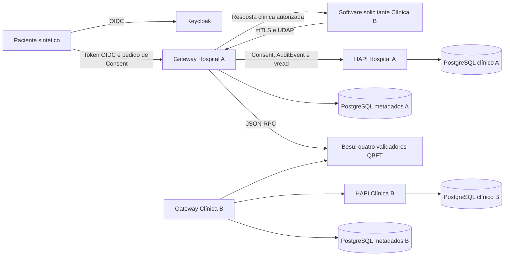
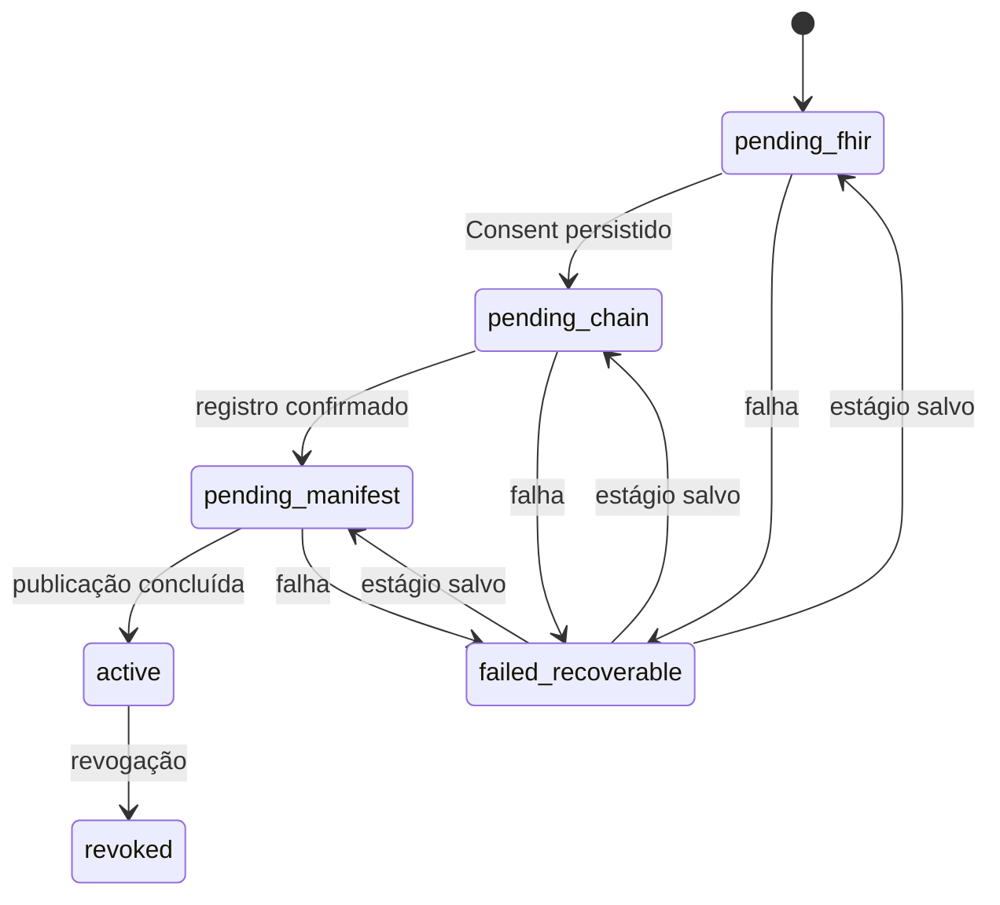
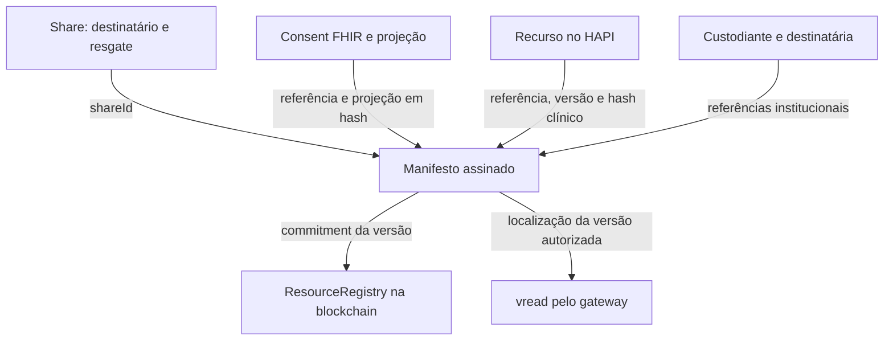
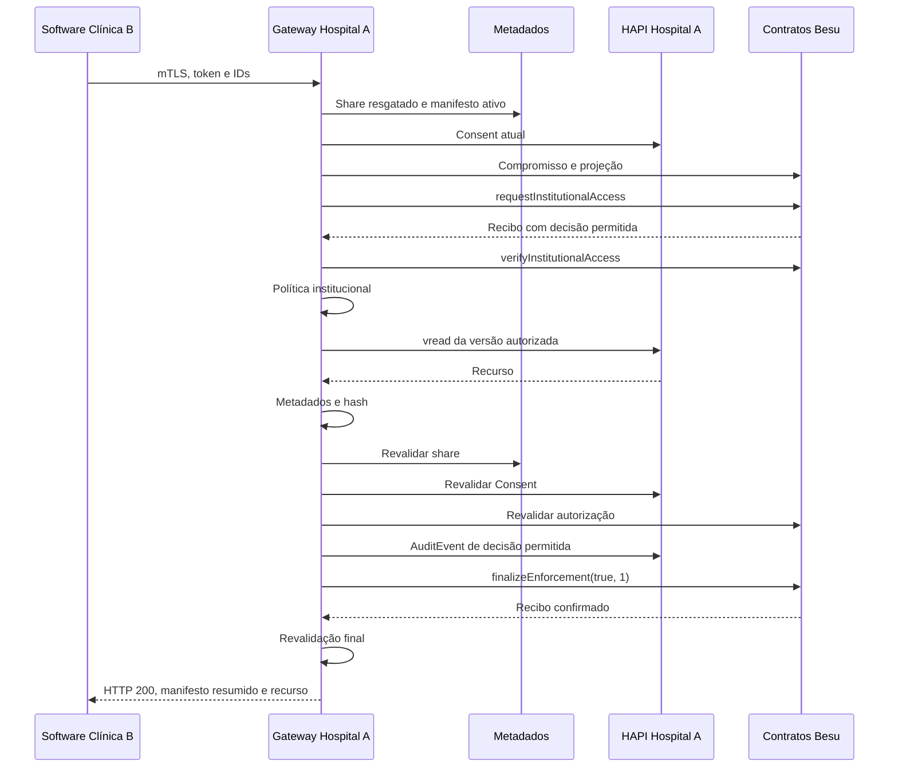

# InterFHIR — documentação principal do projeto

> Avaliação atual da monografia: 15/10/2026, **430 testes e 22 cenários E2E aprovados**, incluindo duas políticas distintas, três profissionais autorizados e adulteração histórica real no HAPI. Consulte a [campanha ampliada](avaliacao-ampliada-2026-10-15.md) para fontes, resultados, reprodução e ocorrência operacional preservada. Os exemplos e relatórios datados de setembro abaixo continuam identificados como históricos.

> Guia técnico conferido com a implementação em 1 de novembro de 2026. Escopo: prova de conceito local, sem frontend. Resultados históricos e novas execuções têm proveniência própria.

**Leitura:** [reprodução](reproducao.md) e [matriz TCC–código](correspondencia-tcc-codigo.md) → este guia → [fluxos ponta a ponta](manual-e2e.md). O [OpenAPI](openapi.yaml) descreve o contrato HTTP. Os arquivos de `reports/runs` são evidências identificadas por execução.

## 1. Objetivo e problema abordado

O InterFHIR implementa acesso interinstitucional a dados de saúde orientado pelo consentimento do paciente. Uma instituição destinatária solicita um recurso mantido pela instituição custodiante. Antes de entregar o dado, o sistema verifica a identidade institucional, o escopo do Consent, a política de acesso e a integridade da versão solicitada.

No fluxo estudado, o **Hospital A** mantém uma observação clínica da paciente sintética **Ana**. A **Clínica B**, representando o profissional **Bruno**, solicita acesso para tratamento. O projeto combina:

- FHIR para recurso clínico, Consent e AuditEvent;
- OIDC para identificar o paciente que cria ou revoga o consentimento;
- mTLS e UDAP para autenticar o software institucional;
- PostgreSQL para compartilhamentos, manifestos, operações e proteção contra replay;
- contratos Solidity em Besu para políticas ABAC, projeções de consentimento, integridade e decisões;
- um gateway que coordena as verificações e controla a resposta HTTP.

A contribuição demonstrável é a integração funcional desses mecanismos em um fluxo rastreável e versionado, mantendo o conteúdo clínico fora da blockchain. Não houve comparação experimental que demonstre superioridade sobre uma arquitetura sem blockchain.

### 1.1 Escopo

A avaliação principal usa duas instituições, quatro validadores locais, dados e identidades sintéticos, um recurso por consentimento e leitura de Observation para TREAT. Existem auxiliares para outros tipos FHIR e finalidades; isso não equivale a validar todos esses fluxos.

Não há frontend, descoberta ampla de pacientes, transferência automática de prontuário, certificação UDAP/FHIR ou implantação produtiva. O profissional é declarado pelo software institucional; não ocorre segundo login humano obrigatório durante a leitura. A campanha de outubro amplia o caso original para duas Observations, três profissionais autorizados e duas políticas adicionais, conforme a [avaliação ampliada](avaliacao-ampliada-2026-10-15.md).

## 2. Vocabulário do projeto

| Termo | Significado nesta implementação |
| --- | --- |
| Custodiante | Organização que mantém o recurso e controla a liberação: Hospital A |
| Destinatária | Organização autorizada a solicitar o recurso: Clínica B |
| Consent FHIR | Documento off-chain com o escopo da autorização do paciente |
| Projeção do Consent | Campos e hashes derivados do Consent, registrados on-chain |
| ShareGrant | Compartilhamento interno: destinatário, período, escopo e resgate |
| Handoff | Código aleatório de uso único para resgatar o compartilhamento |
| Manifesto | Registro assinado que vincula compartilhamento, Consent, recurso e versão |
| Compromisso | Hash que permite comparar um estado esperado com o estado apresentado |
| ABAC | Controle de acesso baseado em atributos |
| PEP | Serviço/conta autorizados a solicitar decisão e aplicar sua execução |
| requestId | Identificador da requisição HTTP e das observações |
| requestHash | Correlação da solicitação de autorização; no sucesso, calculada pelo contrato |
| vread | Leitura FHIR de uma versão específica por /_history/{versionId} |

**Versões independentes:** consentVersion identifica a versão lógica da autorização registrada, distinta do meta.versionId do documento FHIR; manifest.version identifica a versão do manifesto; fhirVersionId identifica a versão clínica. policyVersion identifica separadamente a versão da política.

Handoff não é token nem autorização suficiente. Hash não é criptografia. Manifesto não é o documento clínico. Validador Besu não é gateway FHIR.

## 3. Arquitetura

Antes de observar as conexões, é útil separar três problemas. O primeiro é **guardar e representar o dado clínico**: isso cabe ao HAPI FHIR. O segundo é **coordenar uma solicitação concreta**, identificando o cliente, localizando a versão e devolvendo HTTP: isso cabe ao gateway e ao banco de metadados. O terceiro é **manter regras e registros compartilhados de autorização**, executados segundo um estado replicado: isso cabe aos contratos na rede Besu.

Por exemplo, para entregar uma frequência cardíaca de Ana, a blockchain não procura o exame no HAPI. O gateway procura o manifesto, obtém o contexto necessário para pedir a decisão e, depois de autorizado, lê a versão clínica. Os contratos só enxergam os dados codificados enviados e os registros on-chain existentes. Essa divisão explica por que um contrato sozinho não consegue impedir uma resposta HTTP: quem retém ou envia os bytes é o gateway.

### Como ler as tecnologias na arquitetura

**FHIR é o modelo e a interface de intercâmbio usados pelo projeto; HAPI é o servidor que os implementa.** Uma Observation é um documento estruturado com tipo, identidade, titular e resultado. Uma referência como Observation/obs-ana-1 identifica o recurso; acrescentar /_history/7 seleciona uma versão. O HAPI conserva os recursos em seu PostgreSQL. O gateway usa a API FHIR, sem consultar diretamente as tabelas clínicas do HAPI.

**O gateway é o ponto de aplicação da decisão.** Ele traduz uma solicitação HTTP para verificações de identidade, metadados, Consent e contratos. Seu papel não se limita a encaminhar tráfego: a resposta clínica só é construída depois que o caminho de liberação termina. Por isso, a implementação confia no código e na operação do gateway.

**O banco de metadados mantém o andamento do processo.** Saber que há um Consent não informa se um handoff foi resgatado ou se uma publicação foi interrompida após a ancoragem. Tabelas locais guardam esses estados e permitem recuperá-los. Colocar todos esses estados operacionais na cadeia exigiria mais transações e não eliminaria a necessidade de coordenar o FHIR.

**Keycloak emite identidade; Besu executa regras e registra estado compartilhado.** Um token do paciente não é uma decisão blockchain. Uma decisão blockchain não é um token de login. Esses componentes se encontram na orquestração do gateway, mas resolvem problemas diferentes.



O cliente institucional recebe a resposta. Não há gravação automática no HAPI da Clínica B. Os scripts solicitantes representam o software da Clínica B; não existe uma etapa adicional de encaminhamento por uma rota do gateway B no fluxo principal.

### 3.1 Componentes e responsabilidades

| Componente | Responsabilidade | Código de referência |
| --- | --- | --- |
| Gateway Node.js/TypeScript | TLS, autenticação, HTTP, rotas e composição dos serviços | [start-api.ts](../scripts/start-api.ts), [api-handler.ts](../middleware/src/api/api-handler.ts) |
| Serviço de Consent | Escopo, persistência FHIR, registro on-chain, publicação e revogação | [patient-consent-service.ts](../middleware/src/consent/patient-consent-service.ts) |
| Serviço custodiante | Resgate e consulta de share; entrada da leitura | [custodian-access-service.ts](../middleware/src/interfhir/custodian-access-service.ts) |
| Núcleo de acesso | Consent atual, integridade, autorização, vread e liberação | [health-access-service.ts](../middleware/src/access/health-access-service.ts) |
| Publicação de manifesto | Persistência por estágios, assinatura e ancoragem | [manifest-publication-service.ts](../middleware/src/manifest/manifest-publication-service.ts) |
| Cliente e servidor UDAP | Discovery, cadastro institucional, assertion e token | [udap-client.ts](../middleware/src/udap/udap-client.ts), [udap-token-service.ts](../middleware/src/udap/udap-token-service.ts) |
| Adaptador ethers | ABI, consultas, transações, recibos e decisão confirmada | [ethers-access-client.ts](../middleware/src/blockchain/ethers-access-client.ts) |
| HAPI FHIR | Recursos, Consent, AuditEvent e histórico de versões | [Compose](../docker-compose.yml) |
| Keycloak | Emissão OIDC para identidades sintéticas | [Compose de identidade](../docker-compose.identity.yml) |
| Besu | EVM e replicação dos contratos entre validadores | [Compose blockchain](../docker-compose.blockchain.yml) |
| Avaliador | Cenários reais e evidências sanitizadas | [run-real-e2e.ts](../scripts/e2e/run-real-e2e.ts) |

### 3.2 Distribuição dos dados

| Local | Dados | Limite importante |
| --- | --- | --- |
| HAPI A e seu PostgreSQL | Patient, Observation, Consent, AuditEvent e históricos | Fonte clínica custodiante |
| Metadados A | ShareGrant, manifesto completo, operação, clientes UDAP e JTIs | Contém referências identificáveis; não é anonimizado |
| Blockchain replicada | Hashes, projeções, atributos codificados, políticas, compromissos e eventos | Sem JSON clínico nem Consent integral |
| HAPI/metadados B | Dados próprios | Não recebe cópia automática da Observation |
| Cliente B | Resposta autorizada | Pode persistir os bytes recebidos fora do controle da PoC |
| Configuração local | Chaves e certificados | Não incluir nos relatórios nem no TCC |
| reports/runs | Resultados, proveniência e correlações | Sem tokens, handoffs ou conteúdo clínico |

Tabelas de metadados: consent_operations, share_grants, manifest_headers, manifest_versions, udap_clients e udap_replay_jtis. Seus repositórios estão em middleware/src/consent, share, manifest e udap. A separação entre bancos não elimina os poderes de um administrador do host.

## 4. Consent e criação do compartilhamento

### 4.1 Escopo informado pelo paciente

O Consent é a representação estruturada da vontade de autorizar **determinado uso**, e não uma permissão genérica para ler o prontuário. Neste projeto, “Ana autoriza Bruno, da Clínica B, a ler esta Observation para tratamento até um horário” se transforma em campos verificáveis. Se o profissional, a finalidade ou o prazo mudarem, a solicitação pode deixar de estar dentro dessa autorização.

A política da rede e o Consent se complementam. A política exige, por exemplo, profissional com licença e atributos compatíveis para leitura de tratamento. O Consent escolhe a quem, sobre qual recurso e por quanto tempo o paciente concede acesso dentro desse escopo. Um Consent favorável não torna uma licença inativa válida; uma licença válida não substitui o Consent.

Há ainda uma **projeção** do Consent: uma representação menor, preparada para os contratos, com hashes das referências, códigos e período. Essa transformação torna o escopo utilizável pela EVM sem colocar o JSON FHIR inteiro na cadeia. O gateway compara o Consent atual, sua projeção calculada e os registros on-chain; assim, mudar o documento off-chain sem manter coerência com a projeção não é suficiente para mudar silenciosamente a autorização.

Em **POST /patient/consents**, o corpo informa destinatário, profissional opcional, referência do recurso, finalidade, política/versão e fim da validade. patientReference vem do token OIDC; validFrom é determinado pelo serviço.

Antes dos efeitos, o serviço verifica política conhecida/ativa, organização registrada, vínculo e atividade do profissional e titularidade do recurso. O paciente escolhe um escopo dentro de uma política reconhecida; não cria regras Solidity arbitrárias.

O builder produz Consent ativo, escopo patient-privacy, provision.type=permit, ação read, finalidade TREAT, período e referência do recurso. A extensão local:

```text
https://interfhir.local/fhir/StructureDefinition/network-policy
```

contém um valueIdentifier do sistema https://interfhir.local/policies com valor POLICY_TREATMENT_OBSERVATION@1. Neste builder, organization contém a destinatária. É uma convenção local a explicar, não uma definição geral de toda a semântica FHIR.

### 4.2 Ordem de execução

1. Reservar operação por paciente e Idempotency-Key, com digest do pedido.
2. Criar Consent por PUT em referência determinística e reler a versão persistida.
3. Mapear o Consent e registrar sua projeção por HealthAccessControl.registerPatientConsent.
4. Criar/ativar ShareGrant e emitir handoff de 24 bytes aleatórios.
5. Ler o recurso, persistir/assinar/ancorar o manifesto e ativá-lo.
6. Sincronizar o hash clínico no ResourceRegistry.
7. Marcar operação ativa e devolver HTTP 201 com identificadores e handoff.

O share pode estar ativo internamente antes do manifesto. A criação só retorna sucesso ao final; a leitura também exige manifesto ativo e resgate.



O serviço guarda resumeState e usa lease com token para controlar concorrência. É recuperação por estágios, não transação distribuída.

**Idempotência tem limite:** a resposta com handoff em claro fica em memória. Repetir a mesma chave/escopo no mesmo processo pode recuperar a resposta. Após reinício, uma operação ativa sem resposta em memória retorna IDEMPOTENCY_RESULT_UNAVAILABLE. Não é emitido outro código para o mesmo share. Chave reutilizada com escopo diferente é recusada. Não afirmar recuperação de todo resultado secreto após reinício.

### 4.3 Revogação

POST /patient/consents/{consentReference}/revoke identifica o paciente por OIDC e verifica titularidade. A referência Consent/... precisa ser codificada no segmento da URL. O serviço atualiza Consent, revoga a projeção on-chain e os registros locais/manifestos. Estados intermediários podem exigir retentativa.

A revogação visível nas consultas de revalidação impede a liberação; uma mudança posterior à última consulta relevante pode não ser observada antes do envio. A revogação não recolhe bytes já entregues. Os detalhes de ordenação e efeitos estão no [serviço](../middleware/src/consent/patient-consent-service.ts).

## 5. Manifesto: ligação entre autorização e dado

### O que é e por que existe

Um manifesto é um **registro descritivo de um objeto e das condições às quais ele foi vinculado**. No InterFHIR, ele funciona como uma ficha técnica assinada do recurso que poderá ser entregue. A ficha informa qual recurso é, de qual paciente, em qual instituição, em qual versão e sob qual compartilhamento e projeção de Consent. Ela também permite conferir se o objeto recebido corresponde ao objeto que foi preparado para aquele acesso.

Considere um Consent que menciona Observation/obs-ana-1. Essa referência identifica um recurso lógico: o HAPI pode armazenar as versões 7 e 8 do mesmo recurso. Se a API apenas procurasse a versão mais recente no momento de cada pedido, o resultado poderia ser diferente daquele associado à publicação original. O manifesto registra fhirVersionId=7 e o hash do JSON dessa versão. A leitura passa a ter um alvo definido e verificável.

Outro problema é a relação entre sistemas. O Consent está no FHIR; o resgate está no PostgreSQL; a política e sua projeção estão na blockchain. Nenhum desses registros, isoladamente, fornece a ligação completa necessária para localizar e verificar a versão clínica. O manifesto reúne essas relações em um objeto interno que o gateway consegue consultar, assinar, comparar e usar para construir a chamada aos contratos.

**O que ele integra na prática:**



### Consent, share e manifesto: por que três registros?

| Registro | Pergunta que responde | Exemplo |
| --- | --- | --- |
| Consent | O paciente permite qual acesso? | Bruno pode ler esta Observation para TREAT durante o período |
| ShareGrant | Como esse acesso foi disponibilizado ao destinatário? | Compartilhamento da Clínica B ativo, handoff já resgatado |
| Manifesto | Qual objeto e versão materializam esse compartilhamento? | Observation/obs-ana-1, versão 7, hash RH, vinculada à projeção CP |

O manifesto não autoriza sozinho. Mesmo que sua assinatura esteja correta, uma revogação do Consent ou um profissional diferente pode impedir a leitura. Da mesma forma, conhecer um share não dá liberdade para escolher qualquer recurso: o manifesto ativo restringe o objeto usado pelo gateway.

### Como interpretar seus campos

| Grupo | Campos internos |
| --- | --- |
| Identidade e estado | manifestId, shareId, version, status |
| Participantes | custodianOrganizationReference, granteeOrganizationReference, subjectReference |
| Recurso | resourceReference, resourceType, fhirVersionId, resourceHash |
| Consent | consentReferenceHash, consentProjectionHash |
| Encadeamento | previousVersionCommitment, commitment |
| Assinatura e tempo | signingKeyId, signature, createdAt, updatedAt |

O manifesto completo fica no PostgreSQL custodiante. O cliente recebe resumo de descoberta e, na leitura autorizada, resumo com localização/versão e recurso. Não pode escolher outro locator FHIR pelo corpo da leitura.

manifestId identifica a ficha ao longo das suas versões; shareId a vincula ao compartilhamento. subjectReference impede associar a ficha ao paciente errado. custodianOrganizationReference indica quem mantém o objeto; granteeOrganizationReference indica para quem foi preparado. resourceReference localiza o recurso lógico; fhirVersionId fixa a versão; resourceHash permite comparar seu conteúdo.

consentReferenceHash identifica, por hash, o Consent associado; consentProjectionHash representa seu escopo projetado. São diferentes: dois estados da mesma referência Consent podem manter o primeiro hash e alterar o segundo. commitment representa a ficha como um todo. signingKeyId seleciona a chave esperada, e signature prova consistência com a assinatura do custodiante configurado.

previousVersionCommitment vincula uma transição à versão anterior segundo a representação de estados adotada pela publicação; na primeira versão ele é zero. version e status permitem distinguir ficha ativa, substituída ou revogada. createdAt e updatedAt registram seus tempos e participam do compromisso: não são campos livres para editar sem afetar a verificação.

### 5.1 Algoritmos e significado

- **Referências:** Keccak-256 dos bytes UTF-8, como Patient/pat-ana.
- **Recurso clínico:** Keccak-256 do JSON com chaves dos objetos ordenadas recursivamente; ordem dos arrays preservada. Metadados presentes participam do hash.
- **Projeção do Consent:** hash da representação canônica do escopo de autorização, incluindo vínculo à política.
- **Manifesto:** Keccak-256 da serialização de campos e ordem definidos em [resource-manifest.ts](../middleware/src/manifest/resource-manifest.ts). Estado e timestamps participam; assinatura e próprio commitment não.
- **Assinatura:** JWS compacto ES256 sobre o texto do commitment, com a chave do custodiante configurada.
- **Handoff/assertion:** SHA-256/base64url nos mecanismos correspondentes. Não confundir com o hash clínico.

Assinatura comprova consistência com a chave, não verdade médica. Hash não cifra conteúdo nem anonimiza referências previsíveis.

### 5.2 Publicação e leitura versionada

A sequência é **pending -> anchor -> active**: salvar pendente, construir e assinar sua forma ativa, ancorar o commitment dessa forma e ativar no banco. Alterar status/timestamps exige reconstrução coerente do commitment e da assinatura.

Na leitura, o gateway verifica consistência local, assinatura e registro on-chain da versão. Depois da autorização inicial, pede:

```text
GET /fhir/Observation/obs-ana-1/_history/{fhirVersionId}
```

Confere referência, tipo, titular, versão e hash do JSON retornado. Ler o recurso mais recente seria uma operação diferente.

Atualizar legitimamente o recurso mais recente não é adulterar automaticamente a versão histórica. Há suporte interno à publicação de próximo manifesto, sem rota pública de atualização no fluxo apresentado. O registro de integridade por recurso também precisa permanecer coerente: não prometer leitura perpétua de qualquer versão sob toda atualização possível.

Fontes: [hasher](../middleware/src/fhir/resource-hasher.ts), [assinatura](../middleware/src/manifest/manifest-signer.ts), [publicação](../middleware/src/manifest/manifest-publication-service.ts).

### 5.3 Exemplo de integridade em três níveis

Suponha que o recurso da versão 7 resulte em RH, que a projeção de Consent resulte em CP e que o manifesto completo resulte em MC. O custodiante assina MC e registra MC na blockchain. Esses símbolos são explicativos, não hashes reais.

1. **Comparação interna:** o gateway recalcula MC a partir dos campos lidos do banco. Se alguém alterou fhirVersionId de 7 para 8 sem atualizar o restante, o compromisso já não corresponde.
2. **Origem e ancoragem:** verifica a assinatura com a chave esperada e compara MC ao compromisso ativo da mesma versão no ResourceRegistry. Recalcular um hash no banco não produz uma assinatura válida nem altera o registro on-chain.
3. **Conteúdo entregue:** depois de autorizado, faz vread da versão 7 e recalcula RH. O manifesto íntegro não garante, sozinho, que uma dependência devolveu o objeto correto; essa comparação final verifica o JSON efetivamente recebido.

Cada camada cobre uma relação diferente. Um hash clínico isolado não informa qual Consent autorizou seu acesso. Uma assinatura isolada não prova que aquele estado ainda é o ativo na rede. Uma ancoragem isolada não confirma que os bytes obtidos do HAPI correspondem ao esperado. O fluxo combina as verificações e continua dependente da proteção das chaves e dos poderes administrativos.

### 5.4 Por que o manifesto não fica inteiro na blockchain?

A cadeia precisa do compromisso para comparação e do estado/versionamento para controlar sua utilização. O gateway precisa de referências e detalhes para localizar o objeto. Manter a ficha completa no banco reduz a exposição replicada desses detalhes e mantém a busca operacional no custodiante. Essa separação não anonimiza o sistema: hashes e registros on-chain ainda podem ser correlacionáveis.

O manifesto também não é um arquivo clínico criptografado nem um endereço público de download. A API institucional recebe seus IDs, e o gateway resolve a localização internamente. Só o caminho positivo devolve o resumo com referência/versão junto do recurso.

## 6. Autenticação e confiança

### Por que existem várias autenticações?

Há dois participantes diferentes: o paciente que autoriza e o software institucional que pede a leitura. Há também três formas de comprovação: um token de identidade, um certificado do canal e uma assinatura de mensagem. Elas não são intercambiáveis.

| Mecanismo | O que comprova neste fluxo | Exemplo do que ainda falta verificar |
| --- | --- | --- |
| OIDC do paciente | Token emitido pelo provedor confiável para o titular declarado | Se o recurso solicitado pertence a ele |
| mTLS | Cliente possui a chave do certificado aceito no canal | Qual finalidade e profissional declara na solicitação |
| Assertion UDAP | Software cadastrado assinou uma declaração dirigida ao token endpoint | Se o profissional declarado está no Consent |
| Token institucional | Emissor aceitou a autenticação/contexto e vinculou token ao certificado | Se share, manifesto, Consent e política permitem a leitura |

O servidor não precisa receber a chave privada para verificar uma assinatura. A chave pública permite verificar a mensagem; a chave privada permanece com quem assina. Um certificado associa uma chave pública a uma identidade segundo a CA confiável. Já um JWKS é um conjunto de chaves públicas em JSON; publicá-lo não basta para torná-lo confiável, por isso sua origem/configuração importa.

Um JWT tem header, payload e assinatura. Decodificar o payload permite ler claims, mas não comprova autenticidade. Neste projeto, os verificadores precisam validar assinatura e contexto. A audiência impede usar uma declaração destinada a outro serviço como se tivesse sido emitida para este. Expiração reduz o período de uso; JTI identifica a assertion para rejeitar reutilização. O token resultante, por outro lado, pode servir a mais de uma chamada durante sua validade: resgate e leitura não exigem reenviar a mesma assertion.

### 6.1 Paciente: OIDC

O gateway aceita apenas emissores configurados e verifica assinatura por JWKS, algoritmo, emissor, audiência, expiração e claims obrigatórias. Para criar/revogar Consent, exige principal paciente e usa patientReference do token.

O harness obtém token Keycloak por grant_type=password com usuário sintético e client secret. É simplificação de teste, não fluxo de login produtivo. Papel/especialidade declarados em OIDC não substituem os registros confiáveis da decisão ABAC. Ver [oidc-verifier.ts](../middleware/src/auth/oidc-verifier.ts).

### 6.2 Instituição: mTLS

O cliente valida o servidor contra a CA configurada e apresenta seu certificado. O gateway verifica cadeia e organização esperada. O token institucional inclui cnf["x5t#S256"], vinculando-o ao certificado; trocar o certificado mantendo o token é recusado.

As portas pública e peer são dois listeners da mesma implementação, não APIs inteiramente separadas. No ambiente local, Hospital A espera certificado da Clínica B e vice-versa. Os pedidos de Consent do harness também usam esse transporte, além do OIDC do paciente. Isso não significa que o paciente detenha a chave institucional. /health é exceção para monitoramento.

### 6.3 Instituição: UDAP

1. GET /fhir/.well-known/udap consulta origem previamente confiável.
2. O cliente verifica signed_metadata com JWKS configurado por fonte confiável. Valida RS256/ES256, emissor, iat/exp e correspondência de token_endpoint, registration_endpoint e jwks_uri com a resposta; exige origem HTTPS esperada.
3. POST /udap/register recebe software statement assinado. O servidor usa chaves confiáveis previamente configuradas, verifica audiência, identidade, duração, JTI, organização e certificado, e persiste o cliente.
4. O cliente cria assertion private_key_jwt com **iss === sub === client_id**, audiência no token endpoint, JTI novo e duração máxima de 300 segundos.
5. A extensão hl7-b2b declara profissional, papel, organização e finalidade.
6. POST /udap/token valida cadastro, assinatura, escopo, certificado e replay e emite token com validade de 300 segundos.
7. Rotas institucionais exigem **Authorization: Bearer** e o mesmo certificado mTLS.

A origem é conferida antes da conexão de discovery. O discovery na origem confiável já utiliza certificado mTLS; os endpoints anunciados são verificados antes de transmitir assertions a eles. Não afirmar que nenhum certificado é transmitido antes dos metadados.

**O profissional é declarado pelo software institucional.** Sua referência é comparada ao Consent e à rede, sem autenticação humana independente na leitura. A confiança inclui a correção dessa declaração pelo software autorizado.

Fontes: [cliente](../middleware/src/udap/udap-client.ts), [cadastro](../middleware/src/udap/udap-registration-service.ts), [token](../middleware/src/udap/udap-token-service.ts).

## 7. Handoff e descoberta controlada

O handoff resolve uma etapa de **entrega controlada da referência ao compartilhamento**. O paciente cria a autorização, mas a destinatária ainda precisa identificar qual share lhe foi disponibilizado. O código aleatório permite fazer esse resgate sem expor uma busca ampla por pacientes e recursos na API.

Pense em um protocolo de retirada: apresentar o código não substitui a identificação da organização. O servidor primeiro reconhece a instituição autenticada e depois verifica se o código pertence a um compartilhamento destinado a ela. O mesmo código não deve poder ser consumido por dois resgates concorrentes; por isso, o repositório faz a mudança de estado de forma atômica no PostgreSQL, em vez de apenas manter uma variável em memória.

Guardar o hash significa que o banco não precisa conservar o código em claro para compará-lo. Quando o cliente envia o código, o serviço calcula seu hash e procura/verifica o registro correspondente. A proteção continua dependendo da aleatoriedade do código, do transporte e das condições de uso. Resgate é estado de descoberta, não a decisão ABAC sobre o conteúdo.

O paciente recebe um código de uso único; sua entrega ao destinatário ocorre por canal fora do escopo. O banco guarda apenas hash SHA-256/base64url.

A instituição autenticada chama POST /interfhir/v1/shares/redeem. O banco verifica destinatário, validade e uso prévio e registra atomicamente handoff_redeemed_at. Retorna shareId, manifestId/resourceType e validade. Depois pode usar GET /interfhir/v1/shares/{shareId}.

Resgate é exigido para consulta institucional e leitura: 403 HANDOFF_NOT_REDEEMED antes dele; 409 HANDOFF_CODE_ALREADY_REDEEMED na repetição. O campo de resgate é interno. Conhecer os IDs não dispensa autenticação, resgate, Consent nem ABAC.

## 8. Besu e contratos

### 8.1 Rede

#### O que é o Besu?

Besu é o software executado pelos nós da blockchain. No projeto, ele fornece a rede compatível com Ethereum na qual os contratos Solidity são implantados e executados. Cada nó mantém sua cópia do estado e do histórico; a EVM é o ambiente que interpreta o código dos contratos. O gateway interage com um nó por JSON-RPC, enquanto os nós se comunicam entre si pela rede P2P.

É importante separar **software**, **rede** e **aplicação**. Besu é o cliente de execução; a rede local é formada pelos processos Besu configurados com o mesmo genesis; HealthAccessControl e os registros auxiliares são a aplicação implantada nessa rede. O projeto não envia transações para a rede pública Ethereum e não depende de uma votação humana a cada acesso.

Um nó validador participa da formação dos blocos. Uma conta de aplicação, como a do PEP, assina transações para chamar contratos. São funções distintas: ser o software da Clínica B não transforma automaticamente sua conta de requisição em validador. A chave do nó identifica sua participação na rede; as contas de paciente, administração e PEP possuem seus próprios papéis. Ver [documentação Besu sobre chaves de nós](https://docs.besu-eth.org/public-networks/concepts/node-keys).

#### O que o consenso decide?

O consenso faz os validadores concordarem sobre os blocos e sua ordem. QBFT é um protocolo de autoridade: validadores aprovados se alternam na proposição de blocos, e a confirmação exige um quórum de assinaturas. A rede pode parar de produzir blocos se perder participantes suficientes. Esse acordo sustenta a execução replicada das regras, mas não verifica a verdade médica de uma Observation. Ver [configuração QBFT do Besu](https://docs.besu-eth.org/private-networks/how-to/configure/consensus/qbft).

Em uma rodada, o proponente envia uma proposta. Os validadores verificam sua validade e trocam mensagens de preparação e confirmação. Se a rodada não progride, o protocolo permite mudança de rodada e de proponente. Essa é uma explicação de alto nível das etapas Proposal, Prepare, Commit e RoundChange; o algoritmo completo define suas condições e justificativas. Ver [especificação QBFT v1 da EEA](https://entethalliance.org/specs/qbft/v1/).

Consenso e ABAC operam em níveis diferentes. O contrato pode concluir que uma leitura deve ser negada; os validadores podem concordar perfeitamente com a execução que produziu essa negativa. Aprovar um bloco significa aceitar a transição válida da cadeia, não conceder automaticamente o acesso clínico.

#### Por que quatro validadores e não dois?

No modelo BFT, falha bizantina abrange comportamentos arbitrários, inclusive mensagens conflitantes. Para tolerar f falhas, o dimensionamento clássico exige n ≥ 3f + 1. A documentação de [consenso de autoridade do Besu](https://docs.besu-eth.org/private-networks/concepts/poa) relaciona o número de validadores à tolerância a falhas. Para f=1, o menor conjunto é n=4.

Aplicando o quórum QBFT ao arranjo local:

| Validadores configurados | Quórum de confirmação | Tolerância bizantina do dimensionamento | Consequência de uma parada |
| --- | --- | --- | --- |
| 2 | 2 | 0 | Sobra um, insuficiente para confirmar |
| 4 | 3 | 1 | Sobram três, suficientes sob as hipóteses do protocolo e de comunicação |

Assim, dois validadores poderiam representar visualmente as duas instituições, mas não ofereceriam tolerância a uma falha nesse modelo. Quatro permitem estudar a configuração mínima com tolerância a uma falha. A quantidade de validadores decorre do consenso pretendido, não da quantidade de instituições que trocam o recurso.

Uma forma intuitiva de entender o quórum de três é observar que dois grupos de três, escolhidos dentre quatro participantes, compartilham pelo menos dois membros. Sob a hipótese de no máximo um participante bizantino, essa interseção inclui participante correto. A segurança depende também das regras de votação e bloqueio entre rodadas; a contagem, sozinha, não substitui o protocolo da [EEA](https://entethalliance.org/specs/qbft/v1/).

Os nomes auditor e consortium dão identidade aos outros dois validadores do laboratório. Eles executam a mesma função de consenso que hospital-a e clinic-b. O nó chamado auditor não substitui AuditRegistry, não cria AuditEvent FHIR e não faz auditoria humana dos prontuários.

Essa escolha é uma **justificativa técnica para a topologia atual**, não evidência de um experimento comparativo entre duas e quatro máquinas. Na PoC, todos os nós estão no mesmo host. Uma falha do host pode derrubar os quatro; tolerância do protocolo a um nó não elimina essa causa comum.

#### Como uma chamada chega aos quatro validadores?

O gerador configura o RPC no nó hospital-a e as conexões P2P/allowlist entre os validadores. O gateway envia a transação a esse ponto de entrada; não precisa enviar quatro pedidos HTTP, um para cada validador. O mecanismo da rede distribui a transação e processa sua inclusão em bloco.

Isso cria uma distinção operacional: os demais validadores podem manter quórum se um nó cair, mas a aplicação pode perder seu único endpoint RPC configurado. A continuidade do consenso não garante, sozinha, disponibilidade do gateway. O runtime atual não deve ser descrito como tendo failover automático de RPC apenas por possuir quatro validadores.

Os seis contratos têm endereços na mesma rede; não há um contrato diferente para cada validador. Seus estados são reproduzidos pelos nós. Duas instituições consultam o mesmo estado lógico on-chain, embora mantenham bases FHIR distintas.

#### O que os parâmetros locais significam

Besu 26.5.0 executa quatro validadores locais: hospital-a, clinic-b, auditor e consortium. São processos/volumes de uma mesma máquina, não organizações administrativamente independentes em rede geográfica.

O [gerador](../scripts/generate-besu-network.ts) define chainId 1337, QBFT, período de bloco de 2 segundos, epoch de 30.000 blocos, timeout inicial de 4 segundos e gasLimit de 30.000.000. Não houve campanha completa de falhas bizantinas.

Ethers interage por JSON-RPC: consultas eth_call, envio de transação assinada e consulta de recibos. A EVM executa os contratos Solidity. Confirmação blockchain não equivale a resposta FHIR nem a recebimento clínico.

O genesis é a configuração inicial comum da cadeia: define identidade de rede, conjunto inicial de validadores e regras de execução. Neste gerador, os endereços validadores são codificados em extraData, e alloc provisiona saldo de teste para contas locais. chainId=1337 identifica esta rede para a assinatura das transações; não é ID de paciente ou de instituição.

blockperiodseconds=2 não significa que uma leitura clínica inteira dure dois segundos. O acesso envolve várias transações, consultas, HTTP e validações. gasLimit limita trabalho por bloco; gasUsed de um recibo mede execução EVM daquela transação, não tempo total de resposta. O projeto não implementa mineração competitiva de prova de trabalho, nem apresenta seus saldos locais como custo econômico real.

### 8.2 Contratos

| Contrato | Responsabilidade | Funções centrais |
| --- | --- | --- |
| [HealthAccessControl](../contracts/HealthAccessControl.sol) | Fachada, políticas, PEP e decisões | createPolicyVersion, registerPatientConsent, requestInstitutionalAccess, verifyInstitutionalAccess, finalizeEnforcement, revokePatientConsent |
| [AttributeRegistry](../contracts/AttributeRegistry.sol) | Profissionais, organizações, vínculo, papel/especialidade, atividade/licença | registerOrganization, registerPractitioner, getOrganization, getPractitioner |
| [InstitutionRegistry](../contracts/InstitutionRegistry.sol) | Instituição, gateway, atividade e commitment de metadados | registerInstitution, getInstitution |
| [ConsentRegistry](../contracts/ConsentRegistry.sol) | Projeções, versões e estado do Consent | registerPatientConsentFor, getActivePatientConsentProjection, getPatientConsent, revokePatientConsentFor |
| [ResourceRegistry](../contracts/ResourceRegistry.sol) | Integridade e compromissos de manifesto | registerResourceHash, anchorManifestVersion, isResourceHashValid |
| [AuditRegistry](../contracts/AuditRegistry.sol) | Decisão e revogação | recordDecision, recordConsentRevocation |

Contratos auxiliares têm permissões de escrita e são acionados pela fachada. Variantes desabilitadas do ConsentRegistry não são rotas de uso. Bootstrap cadastra organizações, profissionais, PEPs e políticas; não é repetido a cada leitura.

As chaves Ethereum do paciente sintético, administrador e PEP são controladas pelo backend. O registro do Consent não comprova uso de carteira pessoal pelo paciente. O PEP custodiante solicita a decisão; a Clínica B autentica-se ao gateway por UDAP/mTLS.

#### O que é um contrato neste projeto?

Um contrato é código com estado persistente em um endereço da rede. Sua função pode consultar registros ou, quando executada em uma transação, alterar estado e emitir eventos. Um contrato não é um serviço HTTP separado nem um processo Docker. Chamadas entre contratos são executadas dentro da EVM e podem compor a mesma transação externa.

Por exemplo, uma transação para HealthAccessControl.registerPatientConsent chama internamente ConsentRegistry.registerPatientConsentFor. Isso não exige outra transação assinada pelo paciente para o segundo contrato. O recibo pertence à transação externa e pode conter eventos produzidos por contratos auxiliares. Se essa transação reverter, seus efeitos on-chain revertem juntos; isso não desfaz um PUT FHIR concluído anteriormente.

#### HealthAccessControl — coordenador da decisão e fachada administrativa

É a entrada principal da aplicação na blockchain. Guarda políticas versionadas, PEPs autorizados e decisões temporárias; possui referências aos registros auxiliares. Seu papel é reunir informações para decidir, não armazenar o exame clínico.

Na preparação, funções administrativas registram organizações, profissionais, instituições, política e PEP. Na criação do Consent, registerPatientConsent verifica a política e encaminha o registro ao ConsentRegistry. Na publicação, funções de manifesto/integridade encaminham as alterações ao ResourceRegistry. Na leitura, requestInstitutionalAccess reúne instituição, atributos, Consent, política e integridade e, em caso positivo, grava a decisão.

verifyInstitutionalAccess verifica se a decisão ainda pode ser usada pelo mesmo PEP e se as condições permanecem satisfeitas. finalizeEnforcement emite o evento de finalização; não envia JSON ao destinatário. revokePatientConsent verifica o direito de revogar, altera o Consent e registra a revogação no AuditRegistry.

As políticas estão neste contrato; **não existe PolicyRegistry separado** na implementação. O gateway é o PEP operacional; authorizedPeps é a lista on-chain que limita quais contas podem usar a decisão institucional.

#### AttributeRegistry — atributos confiáveis de organizações e profissionais

Guarda organizações e profissionais identificados pelos hashes das referências. Para o profissional, mantém conta, vínculo à organização, papel, especialidade, licença ativa e estado ativo. Isso fornece a fonte para verificar, por exemplo, se Bruno pertence à Clínica B e possui atributos exigidos pela política.

É escrito no bootstrap e em alterações administrativas, por meio da fachada autorizada. É lido antes de aceitar a criação de um Consent com profissional indicado e durante a decisão/revalidações institucionais. Esses atributos não são aceitos apenas porque um cliente escreveu roleCode ou licenseActive no HTTP.

O registro não consulta conselho profissional externo: licenseActive é um dado administrado na PoC. A confiança recai sobre quem o cadastra. Desativar a licença no registro muda a condição da autorização; possuir um JWT ainda válido não restaura esse atributo.

#### InstitutionRegistry — participação institucional na rede de aplicação

Mantém organizationHash associado a gatewayAccount, metadataCommitment e active. Enquanto AttributeRegistry descreve atributos para ABAC, este registro descreve a participação institucional e sua conta de gateway. Os dois estados podem restringir o acesso: uma organização pode estar cadastrada como atributo e ter sua participação institucional desativada.

É criado pelo construtor de HealthAccessControl e administrado pelas funções da fachada. Na criação do Consent, o gateway lê getInstitution para conferir participação e conta cadastrada. Na decisão institucional, o contrato verifica active; na finalização, também confere instituição ativa e a conta PEP associada à decisão.

O código contém isGatewayAuthorized para comparar instituição/conta, mas o caminho atual de requestInstitutionalAccess se baseia em authorizedPeps, estado institucional e contexto da decisão. Não afirmar que toda leitura chama isGatewayAuthorized, nem que o cadastro de metadataCommitment é automaticamente a verificação de signed_metadata do cliente UDAP. A confiança criptográfica do discovery é implementada separadamente no cliente.

#### ConsentRegistry — escopo e ciclo de vida da autorização on-chain

Mantém a representação contratual do Consent: hashes de titular/destinatário/profissional/recurso, códigos de ação/finalidade/tipo, período, máscara e projeção/versionamento. Não armazena o JSON FHIR integral.

Na criação, a fachada chama registerPatientConsentFor com o escopo e o titular representado pela conta de aplicação. O registro guarda a versão e a projeção ativa. Na leitura, o gateway consulta getActivePatientConsentProjection e getPatientConsent para comparar FHIR e cadeia; a decisão Solidity consulta o consentimento dirigido e a projeção ativa. Portanto, a verificação ocorre tanto na integração quanto dentro das regras contratuais.

Na revogação, revokePatientConsentFor desativa a autorização correspondente e atualiza a projeção. Há suporte a substituição por versão em supersedePatientConsentFor. Manter o histórico de versões permite distinguir “este Consent existiu” de “esta versão ainda autoriza acesso”. Registro antigo não deve ser interpretado como permissão atual.

#### ResourceRegistry — integridade do recurso e estado dos manifestos

Tem duas estruturas distintas. resources associa resourceIdHash a tipo, hash e atividade do recurso. manifests associa manifestIdHash e versão a commitment, status e existência; latestManifestVersion acompanha a versão publicada.

Depois de preparar o Consent e o manifesto, registerResourceHash estabelece o hash usado pela decisão ABAC. anchorManifestVersion registra o compromisso do primeiro manifesto. A leitura consulta o registro do manifesto antes de autorizar, e o contrato de decisão usa isResourceHashValid para comparar o hash clínico esperado. Depois do vread, o gateway recalcula o hash do conteúdo: ResourceRegistry não consegue buscar os bytes no HAPI por conta própria.

As transições de manifesto usam supersedeAndAnchorManifestVersion ou revokeManifestVersion, com compromissos esperados para não sobrescrever silenciosamente outro estado. O registro resources é por recurso lógico, não um histórico ilimitado de todos os hashes clínicos. Essa característica exige cuidado ao sincronizar novas versões e explica a limitação de leitura histórica mencionada na seção 5.

#### AuditRegistry — histórico contratual da decisão e da revogação

Guarda registros numerados de decisão e revogação com hashes, ator/conta, política, razão e timestamp. Também emite AccessDecisionRecorded e ConsentRevocationRecorded. O gateway usa o evento confirmado da decisão para distinguir uma permissão efetiva de uma simulação que só parecia favorável.

No caminho institucional positivo, HealthAccessControl chama recordDecision durante requestInstitutionalAccess. Na revogação, chama recordConsentRevocation. Não se deve concluir que toda negativa passa por AuditRegistry: a negativa por profissional divergente é produzida antes da chamada contratual, e a avaliação institucional que retorna false não necessariamente registra uma decisão negativa neste contrato.

AuditRegistry e AuditEvent se complementam, mas são objetos diferentes. O primeiro está na cadeia e registra a decisão contratual; o segundo é um recurso FHIR criado pelo gateway. O evento EnforcementFinalized é emitido por **HealthAccessControl**, não pelo AuditRegistry. Nenhum deles é um comprovante assinado de recebimento pela Clínica B.

#### Implantação e permissões entre os contratos

O [deploy](../scripts/deploy-json-rpc.ts) implanta AttributeRegistry, ConsentRegistry, AuditRegistry e ResourceRegistry; depois implanta HealthAccessControl, cujo construtor cria InstitutionRegistry. Transfere o controle de escrita de atributos/recursos à fachada e autoriza a fachada a escrever nos registros de Consent/auditoria. Também configura a conta sintética do paciente como controlador de Consent.

Essa preparação permite que a aplicação use uma fachada sem abrir escrita irrestrita em cada registro. As funções administrativas de HealthAccessControl continuam controladas por owner. A existência de vários contratos organiza responsabilidades; não significa governança descentralizada de todos os poderes administrativos.

#### Quando cada contrato participa: mapa completo do fluxo principal

“Consulta” abaixo é uma leitura de estado. “Transação” é uma chamada externa assinada; chamadas auxiliares listadas na mesma linha integram sua execução, sem multiplicar automaticamente o número de transações.

| Momento | Entrada externa | Contratos consultados ou acionados | Tipo e resultado |
| --- | --- | --- | --- |
| Preparação de rede de aplicação | Funções administrativas da fachada | HealthAccessControl, AttributeRegistry, InstitutionRegistry | Transações de cadastro/política/PEP |
| Validar pedido de Consent | getActivePolicy, practitioners, getInstitution | HealthAccessControl, AttributeRegistry, InstitutionRegistry | Consultas; ainda sem consentimento novo |
| Registrar Consent | registerPatientConsent | HealthAccessControl → ConsentRegistry | Transação; projeção/versão registradas |
| Publicar manifesto | getManifestRecord, anchorManifestVersion | HealthAccessControl → ResourceRegistry | Consulta de recuperação; transação de ancoragem quando necessária |
| Sincronizar integridade | registerResourceHash | HealthAccessControl → ResourceRegistry | Transação; hash do recurso atualizado |
| OIDC, discovery, cadastro/token UDAP | Endpoints de identidade | Nenhum contrato no caminho desses endpoints | HTTP e persistência de identidade/replay |
| Resgatar/consultar share | Endpoints institucionais de share | Nenhum contrato nesse caminho | PostgreSQL; sem decisão ABAC ainda |
| Conferir manifesto na leitura | getManifestRecord | HealthAccessControl → ResourceRegistry | Consulta do compromisso e status |
| Conferir Consent atual | getActivePatientConsentProjection, getPatientConsent | ConsentRegistry | Consultas comparadas ao FHIR |
| Solicitar autorização | requestInstitutionalAccess | HealthAccessControl lê InstitutionRegistry, AttributeRegistry, ConsentRegistry, ResourceRegistry; no permit escreve AuditRegistry | Transação de decisão |
| Verificar/revalidar | verifyInstitutionalAccess | HealthAccessControl e registros usados na autorização | Simulação, transação e consulta posterior no adaptador atual |
| Ler recurso e gravar AuditEvent | FHIR vread e POST AuditEvent | Nenhum contrato executa o HTTP | Chamadas do gateway ao HAPI |
| Finalizar | finalizeEnforcement | HealthAccessControl lê InstitutionRegistry e emite evento | Transação antes da resposta, seguida de revalidação |
| Revogar | revokePatientConsent e revokeManifestVersion | HealthAccessControl → ConsentRegistry/AuditRegistry; depois ResourceRegistry | Transações intercaladas com alterações FHIR/banco |

Esse mapa explica por que “usa blockchain” não significa “todo endpoint gera uma transação”. Também explica por que a disponibilidade de Besu é necessária para a liberação, embora a blockchain não contenha o dado clínico.

### 8.3 ABAC

A política central é POLICY_TREATMENT_OBSERVATION@1: Observation, read, TREAT, papel 1 e especialidade 1. Códigos de recurso/ação/finalidade são 1/1/1. A máscara exigida é 3839, abrangendo papel profissional, organização autorizada, licença, recurso, leitura, tratamento, Consent ativo, período, integridade, titular e solicitante.

O contrato deriva os atributos de seus registros. A máscara enviada não basta para conceder acesso. Verifica instituição, vínculo/licença/atividade do profissional, escopo do Consent, projeção e versão ativas, política/escopo/papel/especialidade e integridade; compara os atributos efetivos às máscaras da política e do Consent.

requestInstitutionalAccess exige PEP autorizado. No permit, registra decisão e emite AccessDecisionRecorded no AuditRegistry. O adaptador interpreta o evento no recibo: transação minerada com sucesso não significa necessariamente autorização, pois o contrato pode retornar falso.

verifyInstitutionalAccess confere conta, organização, decisão com TTL de 300 segundos e estado atual. O adaptador faz simulação, transação e consulta posterior. Os tempos são fornecidos na requisição/verificação; o gateway revalida o Consent com relógio atualizado. Não descrever isso como uma garantia temporal totalmente independente do gateway.

Fontes: [política](../middleware/src/authorization/policy-definition.ts), [máscaras](../middleware/src/abac/policy-mask.ts), [contrato](../contracts/HealthAccessControl.sol).

## 9. Caminho de leitura e liberação

POST /interfhir/v1/access/read recebe shareId, manifestId, operation=read, purposeOfUse e requestId. Organização, profissional e assertionHash vêm do token verificado; a referência clínica vem do manifesto interno.



A política institucional adicional pode restringir o permit da rede, nunca converter negativa on-chain em liberação.

Antes do vread, a decisão usa Consent, hashes e metadados. Depois do vread, o conteúdo fica retido no gateway até concluir integridade, auditoria e revalidações. Leitura interna não é entrega.

Falha na auditoria obrigatória retorna **503 AUDIT_UNAVAILABLE**; falha na finalização retorna **503 BLOCKCHAIN_UNAVAILABLE**. Ambas sem recurso clínico. Não existe sucesso com x-access-audit-status: pending.

Negativas podem usar auditoria best-effort para preservar a falha original. Não há garantia de AuditEvent para toda rejeição que ocorre antes do núcleo.

### 9.1 Semântica das evidências

| Registro | O que indica |
| --- | --- |
| AuditEvent ACCESS_DECISION_PERMITTED | Decisão permitida registrada no FHIR |
| AccessDecisionRecorded | Decisão registrada on-chain |
| EnforcementFinalized(delivered=true) | Fase de liberação confirmada pelo PEP |
| HTTP 200 observado pelo cliente | Resposta de sucesso recebida pelo cliente do teste |

Nenhum evento isolado prova leitura humana, recebimento remoto definitivo ou incorporação ao prontuário.

Há nova revalidação após EnforcementFinalized, capaz de negar a resposta. Um evento delivered=true pode coexistir com negativa posterior. Existe janela entre última verificação e envio; não há atomicidade entre FHIR, PostgreSQL, blockchain e rede.

## 10. Interfaces HTTP

| Método e endpoint | Autenticação/uso | Resposta principal |
| --- | --- | --- |
| GET /health | Monitoramento | 200/503 |
| GET /fhir/.well-known/udap | Discovery no transporte configurado | 200 metadados |
| GET /.well-known/udap/jwks.json | Chaves públicas | 200 JWKS |
| POST /udap/register | mTLS e software statement | 201 cadastro |
| POST /udap/token | mTLS e private_key_jwt | 200 token |
| POST /patient/consents | OIDC paciente e transporte local | 201 |
| POST /patient/consents/{consentReference}/revoke | OIDC paciente | 200 |
| POST /interfhir/v1/shares/redeem | UDAP e mTLS | 200 resumo |
| GET /interfhir/v1/shares/{shareId} | UDAP e mTLS; exige resgate | 200 resumo |
| POST /interfhir/v1/access/read | UDAP, mTLS e autorização | 200 manifesto resumido + recurso |

O [OpenAPI](openapi.yaml) define esquemas e erros. /patient/shares, /access/read, /access/read-manifest e antigas rotas administrativas não são o fluxo principal. Leituras legadas retornam 410 LEGACY_READ_ROUTE_DISABLED. /fhir/{path} no gateway é bloqueado com 403 FHIR_DIRECT_ACCESS_BLOCKED, exceto discovery tratado antes.

Erros usam corpo **sem payload clínico**, normalmente {"error":"CODIGO"}, com field opcional para validação. JSON inválido: 400; corpo maior que 1 MiB: 413; prazo de corpo de 30 segundos: 408. Desconexões e rejeições assíncronas são contidas.

## 11. Execução local e reprodução

### 11.1 Ambiente e isolamento

O laboratório Docker/Keycloak/Postgres tem 13 serviços (a prontidão E2E verifica 16 pontos, incluindo endpoints adicionais): dois gateways, dois HAPI, quatro PostgreSQL, um Keycloak e quatro Besu. PostgreSQL usa 16-alpine; Keycloak 26.1; as imagens HAPI/gateway são construídas pelo projeto. package-lock.json fixa dependências Node; ensaios arquivados usaram Node 24.10.0 e npm 11.6.1.

O identificador padrão é interfhir-<hash-da-raiz>. Redes/volumes têm escopo e rótulos da raiz. Checkout comum e worktree são aceitos; o ciclo de vida utiliza os quatro Compose completos e seleciona serviços/perfil.

| Serviço | Acesso local padrão |
| --- | --- |
| Gateway A / peer | https://localhost:3001 / https://localhost:4001 |
| Gateway B / peer | https://localhost:3002 / https://localhost:4002 |
| HAPI A / B diagnóstico | http://localhost:8081/fhir / http://localhost:8082/fhir |
| Metadados A / B | localhost:5433 / localhost:5435 |
| Keycloak | http://localhost:8180 |
| RPC Besu | http://localhost:8546 |

Bindings diagnósticos usam loopback. Links FHIR internos usam HTTP: não afirmar TLS em todos os enlaces. Bloquear /fhir no gateway não impede acesso diagnóstico por administradores do host.

### 11.2 Comandos

O [protocolo de reprodução](reproducao.md) é a referência para pré-requisitos, instalação limpa, sequência de execução, confirmação dos resultados e diagnóstico. `e2e:up` prepara PKI, chaves, configurações, contratos, participantes e políticas experimentais. `npm test` exige a infraestrutura de integração pronta; dependência indisponível não conta como aprovação.

O nome do projeto Docker deriva do caminho do clone. Portas e sub-rede são configuráveis por `INTERFHIR_*_HOST_PORT` e `INTERFHIR_BESU_SUBNET`; os valores estão em [runtime-environment.ts](../scripts/runtime-environment.ts). O preflight impede sobreposição com recursos de outro projeto. Os identificadores concretos dos laboratórios históricos não devem ser copiados como configuração universal.

`e2e:down` preserva volumes; `e2e:reset -- --discard-data` descarta os volumes Compose do projeto. Chaves e outros arquivos de `.local` não são apagados por esse reset. Para uma reprodução sem estado anterior, prefira outro clone e os volumes próprios dessa raiz.

### 11.3 Antecedentes históricos de setembro

Observações históricas de 6/9/2026, não testes reexecutados a cada edição documental. Revisão base: 49cdc8b348edcbec4cf95e8a53225e6dadad435c, checkout modificado. Suíte e dois E2E finais registram hash dos fontes **4d02a8d2d18f5484f57b89f6280154c9df627165d6ff2c17f94277a78a4a0707**.

| Evidência | Resultado |
| --- | --- |
| [Suíte completa](../reports/runs/2026-09-06T17-18-37-794Z-98514cf4/tests-all.json) | 412 aprovados, 0 falhos, 0 pendentes, 55 arquivos |
| [E2E após reinício](../reports/runs/2026-09-06T17-19-54-731Z-aa811b9e/e2e.json) | 14/14 |
| [E2E repetição](../reports/runs/2026-09-06T22-55-58-104Z-9f39994a/e2e.json) | 14/14 na mesma revisão dos fontes |
| [Leitura correlacionada](../reports/runs/2026-09-06T22-56-41-726Z-88a8dfb2/access-evidence.json) | requestId, AuditEvent, recibo/evento |
| [Runtime](../reports/runs/2026-09-06T23-00-17-907Z-371a6ab1/runtime-status.json) | 13 serviços saudáveis no instante observado |

Duas aprovações anteriores ocorreram às 17:06 e 17:10, em outros hashes. A execução bloqueada às 17:03 por requestId inválido do avaliador foi preservada e não conta como aprovação. Não somar revisões diferentes como uma campanha controlada única.

Houve intervenção operacional: recuperação de gateways, renovação de metadados expirados e erro OCI de healthcheck Docker resolvido recriando isoladamente um HAPI com volume preservado. Não descrever a campanha como execução contínua sem intervenção.

### 11.4 Matriz requisito–teste–evidência

| Afirmação | Evidência existente | Limite |
| --- | --- | --- |
| Leitura autorizada versionada | E2E authorized-consent-read + access-evidence | Observation/TREAT sintético |
| Profissional, instituição e finalidade incorretos negados | E2E wrong-practitioner, wrong-organization, purpose-mismatch | Negativas específicas |
| Revogação/expiração | E2E revoked-consent, expired-consent | Durante leitura: testes unitários |
| Handoff único/persistência | E2E handoff-replay + PostgreSQL | Não é replay de token |
| Assertion não reutilizável | E2E assertion-replay | Token pode ser reutilizado enquanto válido |
| Token vinculado a certificado | E2E certificate-token-mismatch | Configuração institucional local |
| Integridade do manifesto | E2E tampered-manifest, tampered-fhir-version | Alteram metadados locais; verificação antes de vread |
| Integridade depois de vread | E2E `tampered-historical-fhir-content` e `authorized-restored-historical-version`; testes de serviço complementares | Outubro: bytes históricos efetivamente alterados no HAPI, retenção por hash e restauração; metadados divergentes isolados em serviço |
| Dependências indisponíveis | E2E blockchain-unavailable, metadata-postgres-unavailable | Não todas as dependências |
| Sem cópia automática em B | Avaliador consulta B após sucesso | Cliente ainda pode persistir |
| Auditoria/finalização obrigatórias | health-access-service.test.ts e sucesso real | Falhas injetadas demonstradas em unitários |
| Confiança signed_metadata | udap-client.test.ts | Não extrapolar para campanha E2E completa |
| Robustez HTTP | http-robustness.test.ts | Dependências simuladas |
| API/documentação | docs:check e docs-check.test.ts | Não certifica todo o padrão |

Localizar os casos e seus status no JSON da suíte. Existência do arquivo de teste, sozinha, não prova aprovação. Os 14 cenários de setembro estão no [documento dos fluxos](manual-e2e.md); os 22 de outubro, na [avaliação ampliada](avaliacao-ampliada-2026-10-15.md).

Observações do gateway e consultas auxiliares do avaliador são separadas. Nem toda negativa anterior ao núcleo tem observabilidade que prove universalmente zero vread; ausência de observação deve permanecer desconhecida.

## 12. Limitações da avaliação

A evidência sustenta funcionamento local do fluxo principal e negativas selecionadas. Não certifica segurança, conformidade regulatória ou prontidão produtiva.

Ameaças à validade: dados sintéticos; mesma máquina; confiança no gateway/relógio/CA/chaves; profissional declarado pelo software; carteira sintética no backend; ausência de atomicidade; auditoria sem prova de recebimento; correlação possível por metadados; cobertura limitada de recursos/ataques/falhas.

O protocolo de desempenho de três rodadas, aquecimentos e 30 amostras por operação **não foi concluído**. Latência isolada e gasUsed de um recibo não são benchmark, TPS ou custo monetário produtivo. Permanecem fora da campanha funcional ensaios de carga, partições, falhas bizantinas e operação por instituições independentes.

Código e relatórios demonstram esta implementação; as fontes teóricas sobre FHIR, UDAP, consenso e controle de acesso fundamentam critérios distintos. A [matriz TCC–código](correspondencia-tcc-codigo.md) separa essas classes de evidência.

## 13. Mapa de leitura do código

1. Entrada e identidade: scripts/start-api.ts; middleware/src/api; middleware/src/auth.
2. Cadastro e token institucional: middleware/src/udap.
3. Consent e estados: middleware/src/consent; middleware/src/fhir/consent-builder.ts e consent-mapper.ts.
4. Share/handoff: middleware/src/share; middleware/src/interfhir/custodian-access-service.ts.
5. Manifesto: middleware/src/manifest; middleware/src/fhir/resource-hasher.ts.
6. ABAC e liberação: middleware/src/access; middleware/src/abac; middleware/src/policy; contracts.
7. Auditoria: middleware/src/fhir/audit-event.ts; contracts/AuditRegistry.sol.
8. Experimentos: scripts/e2e/run-real-e2e.ts; scripts/run-tests.ts; reports/runs.
